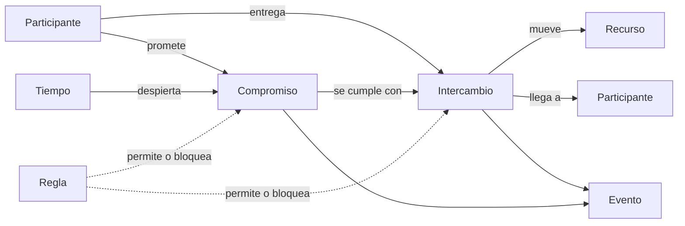

# Modelo universal: las siete piezas

Cualquier ecosistema se describe con siete piezas. Un gimnasio, una tienda, una familia que ahorra o una comunidad son la misma combinación con distintos nombres.

| # | Pieza | Responde | Ejemplos |
|---|---|---|---|
| 1 | **Participante** | ¿Quién? | Una persona, una organización, un agente de IA |
| 2 | **Recurso** | ¿Qué tiene valor? | Dinero, tiempo, objetos, conocimiento, acceso |
| 3 | **Intercambio** | ¿Qué valor se movió? | Una venta, un pago, una hora trabajada |
| 4 | **Compromiso** | ¿Qué valor se prometió? | Una deuda, una membresía, una cita, una meta |
| 5 | **Evento** | ¿Qué pasó? | Todo lo anterior queda registrado; es la memoria |
| 6 | **Tiempo** | ¿Cuándo? | Plazos, ciclos y vencimientos que despiertan compromisos |
| 7 | **Regla** | ¿Quién puede y qué debe pasar solo? | Permisos, políticas, automatizaciones |

## El mismo modelo en distintos mundos

| Pieza | Gimnasio | Tienda | Comunidad | Persona |
|---|---|---|---|---|
| Participante | Socio, entrenador | Cliente, proveedor | Miembro, junta | Yo, mi familia |
| Recurso | Plan mensual, acceso | Producto, dinero | Cuota, fondo común | Ingreso, ahorro |
| Intercambio | Pago del plan | Venta | Aporte | Gasto |
| Compromiso | Membresía vigente | Factura por cobrar | Cuota del mes | Meta de ahorro |
| Tiempo | Vence el día 30 | Plazo de 30 días | Asamblea anual | Fin de mes |
| Regla | Sin plan no entra | Sin stock no vende | Solo la junta aprueba | Tope de gasto |

Por eso el kernel no cambia entre mundos: cambia el traductor.
