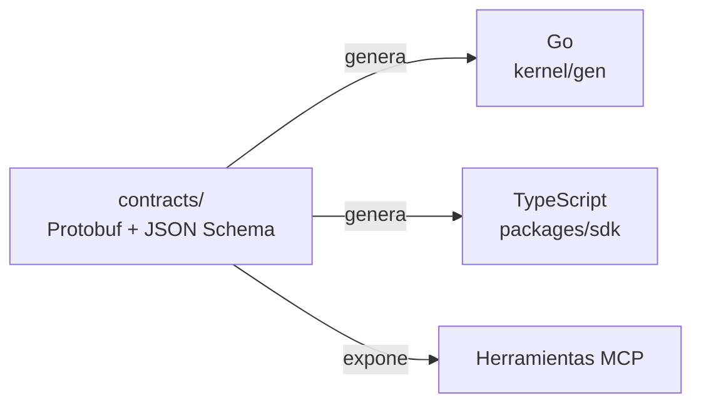

# Contrato

## Propósito

Definir el único idioma entre las piezas de NexusThrive y cómo se genera el código de cada lado.

## Alcance

Operaciones, eventos y errores de todas las capas. Las listas de operaciones de cada capa están en su documentación.

## Conceptos principales

| Parte | Formato | Paquetes |
|---|---|---|
| Operaciones | Protobuf con Connect-RPC | `kernel.v1`, `platform.v1`, `business.v1` |
| Eventos | JSON Schema versionado | `kernel.space.created.v1`, `platform.charge.confirmed.v1` |
| Errores | Códigos tipados | `permission_denied`, `capability_inactive`, `rule_violation`, `not_found`, `already_done`, `invalid_input`, `space_suspended`, `idempotency_conflict` |

En M2 se genera Go y TypeScript. El SDK Python y otros lenguajes permanecen pospuestos por el ADR-0018; el ADR-0004 conserva la visión general del contrato.

## Contrato inicial de M2 (decisión aceptada)

El [ADR-0037](../05-decisiones/0037-contrato-inicial-del-kernel.md), aceptado por santy401 el 2026-11-15 en HU-gateway-01, define `KernelService.WriteExchange` (`kernel.exchange.write`, riesgo `money`, idempotencia obligatoria) y `KernelService.ReadEvents` (`kernel.event.read`, riesgo `read`). La escritura exige tanto `kernel.exchange.write` como `kernel.commitment.write` y registra intercambio, compromiso, evento y outbox juntos. Ninguna operación exige una capacidad adicional.

La decisión define entradas, respuestas, errores, la clave en el campo `idempotency_key`, métodos específicos del `Engine` para preservar el prefijo reservado y plugins locales con versiones fijadas. El código `retryable` ya está implementado en el motor para abortos `40001` y `40P01`, sin reintento automático; un privilegio faltante sigue siendo un error de infraestructura. El transporte inicial para dinero es JSON, para conservar el cuerpo original que exige la idempotencia del motor.

El ADR está **Aceptado**. HU-gateway-08 incorpora los contratos en `contracts/proto/kernel/v1`, el esquema del payload en `contracts/events/kernel.exchange.recorded.v1.json` y código generado en `kernel/gen` y `packages/sdk/src/gen`. HU-gateway-09 implementa `Engine.WriteExchange` y `Engine.ReadEvents` mediante manejadores internos fijos y políticas generadas; la exposición Connect por la puerta sigue pendiente de HU-gateway-10. El corte HTTP vigente está descrito en el [ADR-0036](../05-decisiones/0036-primera-puerta-http-del-kernel.md).

### Preparación y generación

1. `pnpm install --frozen-lockfile` instala el generador TypeScript fijado y las dependencias.
2. `task tools:contracts` instala Buf 1.50.0, protoc-gen-go 1.36.5 y protoc-gen-connect-go 1.18.1 en `tools/bin` (ignorado por Git). Esta preparación requiere red; el generador ES está fijado en 2.2.3.
3. `task gen` utiliza solo ejecutables locales y genera Go y TypeScript sin acceso a red. Los archivos generados se versionan.
4. `task contracts:check` ejecuta lint y compatibilidad contra `CONTRACT_BASE_REF` (por defecto `main`). Una base sin `.proto` informa expresamente el arranque inicial; una referencia inválida falla.

CI prepara las herramientas, ejecuta la comparación contra el commit base del PR, genera dos veces y rechaza diferencias o archivos generados sin seguimiento. Las pruebas comprueban que renombrar un campo rompe compatibilidad, que una segunda generación conserva todos los bytes, que los decimales y cursores conservan precisión y que el evento rechaza payloads inválidos.

## Funcionamiento

- Cada operación declara su **permiso**, su **capacidad**, su **riesgo** (`read`, `write`, `money`) y si es **idempotente**. Las de dinero siempre lo son.
  Los contratos nuevos declaran esa política mediante `OperationPolicy` en las opciones de cada método. El motor existente todavía usa `execution.Operation` ([ADR-0035](../05-decisiones/0035-motor-de-ejecucion.md)); HU-gateway-09 consumirá las declaraciones generadas: una **lista** de permisos que se verifican todos, una capacidad opcional, el riesgo (igual al mayor de sus permisos) y la idempotencia. El motor se niega a registrar una operación de dinero sin idempotencia.
  Una operación idempotente recibe una **clave** (`^[A-Za-z0-9._:-]{1,128}$`) y el cuerpo de la solicitud: repetir la misma clave con la misma **huella** (operación, actor y cuerpo canónico) devuelve la respuesta guardada sin ejecutar de nuevo, y la misma clave con otra huella devuelve `idempotency_conflict` ([ADR-0026](../05-decisiones/0026-idempotencia-por-registro.md)). El registro vence a las 24 horas.
- Los nombres de operaciones, campos y eventos están en inglés.
- Los eventos llevan versión. Un cambio incompatible crea `.v2`; el anterior se mantiene durante un periodo de transición.
- `buf lint` y `buf breaking` corren en el CI.

## Reglas e invariantes

1. Nada se escribe a mano en los extremos: si falta algo, se agrega al contrato y se regenera (`task gen`).
2. Un cambio de contrato se revisa junto con las capas que lo usan, en el mismo pull request.

## Decisiones relacionadas

- [ADR-0004 · Contrato único](../05-decisiones/0004-contrato-unico.md)
- [ADR-0018 · Recorte de la etapa 1](../05-decisiones/0018-recorte-de-la-etapa-1.md)
- [ADR-0037 · Contrato inicial del kernel](../05-decisiones/0037-contrato-inicial-del-kernel.md)
