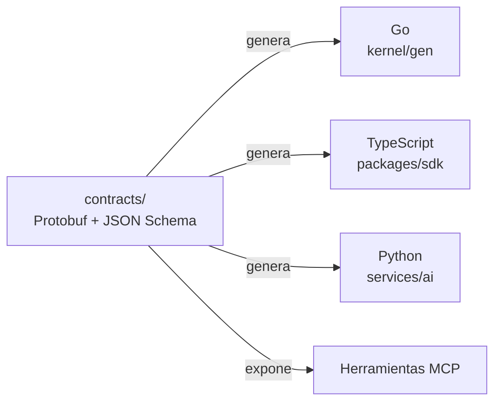

# Contrato

## Propósito

Definir el único idioma entre las piezas de NexusThrive y cómo se genera el código de cada lado.

## Alcance

Operaciones, eventos y errores de todas las capas. Las listas de operaciones de cada capa están en su documentación.

## Conceptos principales

| Parte | Formato | Paquetes |
|---|---|---|
| Operaciones | Protobuf con Connect-RPC | `kernel.v1`, `platform.v1`, `business.v1` |
| Eventos | JSON Schema versionado | `kernel.space.created.v1`, `platform.charge.confirmed.v1` |
| Errores | Códigos tipados | `permission_denied`, `capability_inactive`, `rule_violation`, `not_found`, `already_done`, `invalid_input`, `space_suspended` |

## Funcionamiento

- Cada operación declara su **permiso**, su **capacidad**, su **riesgo** (`read`, `write`, `money`) y si es **idempotente**. Las de dinero siempre lo son.
- Los nombres de operaciones, campos y eventos están en inglés.
- Los eventos llevan versión. Un cambio incompatible crea `.v2`; el anterior se mantiene durante un periodo de transición.
- `buf lint` y `buf breaking` corren en el CI.

## Reglas e invariantes

1. Nada se escribe a mano en los extremos: si falta algo, se agrega al contrato y se regenera (`task gen`).
2. Un cambio de contrato se revisa junto con las capas que lo usan, en el mismo pull request.

## Decisiones relacionadas

- [ADR-0004 · Contrato único](../05-decisiones/0004-contrato-unico.md)
