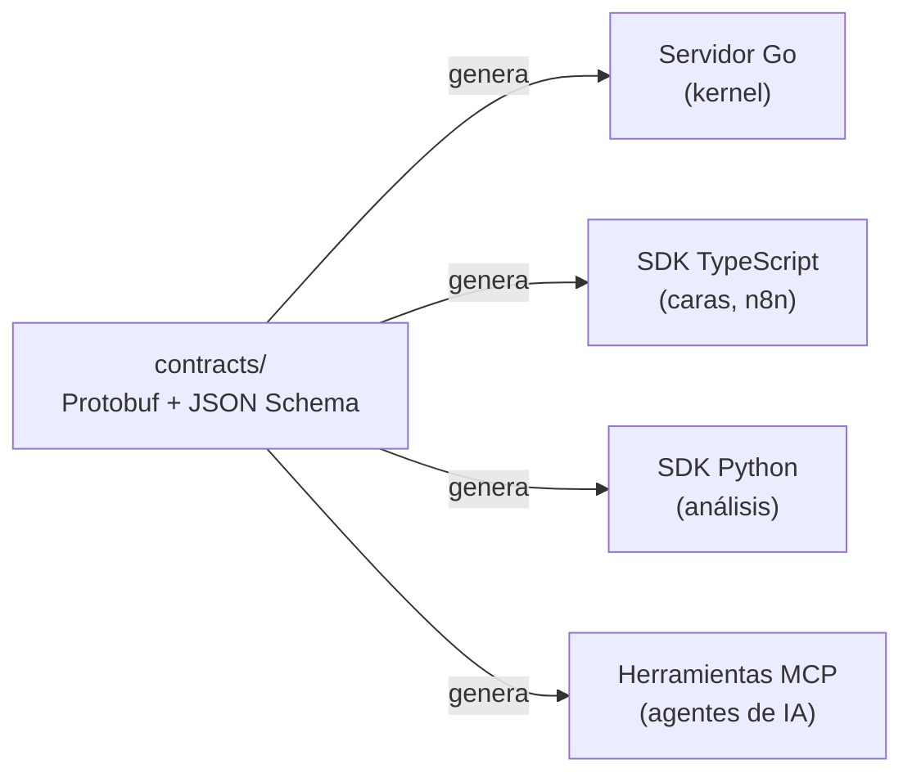

# El contrato

El contrato es el único idioma entre las piezas. Se escribe una vez, fuera de cualquier lenguaje, y de él se genera el código de cada lado.

## Qué contiene

| Parte | Formato | Ejemplo |
|---|---|---|
| **Operaciones** | Protobuf con Connect-RPC | `business.memberships.Assign`, `business.sales.Record` |
| **Eventos** | JSON Schema versionado | `business.membership.assigned.v1` |
| **Errores** | Códigos tipados | `permission_denied`, `rule_violation`, `already_done` |

## Reglas del contrato

1. **Toda operación declara** su permiso, su capacidad, su riesgo (lectura, escritura, dinero) y si es idempotente.
2. **Todo evento lleva versión** (`.v1`). Un cambio que rompe crea `.v2`; el anterior se mantiene un tiempo.
3. **Nada se escribe a mano** del lado de Go ni de TypeScript: si falta algo, se agrega al contrato y se regenera.
4. **Un cambio de contrato** se revisa junto con el kernel y las caras en el mismo cambio. Por eso vivimos en un monorepo.
