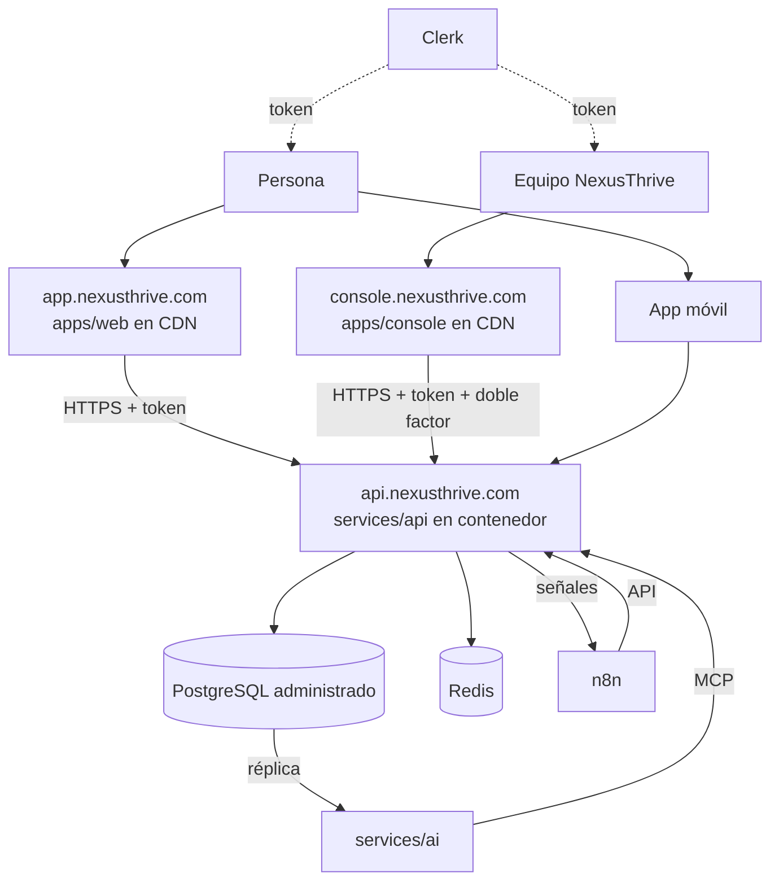

# Despliegue

## Propósito

Definir dónde corre cada pieza en producción.

## Alcance

Entorno de producción. El entorno local está en [`07-ingenieria/development-setup.md`](../07-ingenieria/development-setup.md).

## Funcionamiento

| Pieza | Dónde | Notas |
|---|---|---|
| `apps/web`, `apps/console` | CDN (Cloudflare Pages, Vercel o Netlify) | Solo archivos estáticos; la consola en un dominio propio |
| `services/api` | Contenedor (Fly.io, Railway o Render; luego AWS o GCP) | Único con acceso a la base |
| PostgreSQL | Administrado (Neon, Supabase o RDS) | Con réplica de lectura y copias diarias |
| Redis | Administrado | Caché y sesiones |
| `services/ai` | Contenedor aparte | Lee la réplica |
| n8n | Instancia propia | Solo habla con la API |
| `apps/mobile` | App Store y Google Play con Expo | |
| `apps/desktop` | Instaladores Tauri | |

## Reglas e invariantes

- Tres entornos: `local`, `staging` y `production`, con bases separadas.
- Los secretos viven en el gestor del proveedor, nunca en el repositorio.
