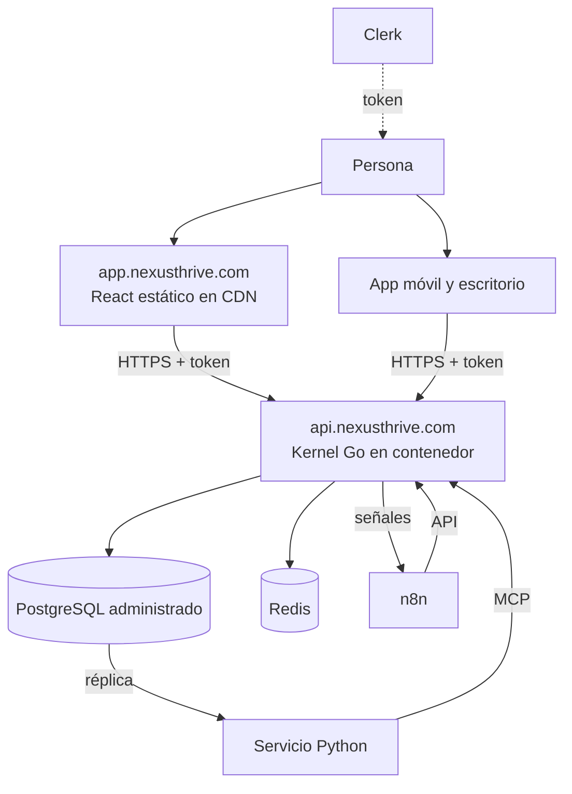

# Despliegue

Cada pieza vive en su propio lugar. Cambiar una no obliga a tocar las demás.

| Pieza | Dónde | Notas |
|---|---|---|
| Caras web | CDN (Cloudflare Pages, Vercel o Netlify) | Solo archivos estáticos |
| Kernel | Contenedor (Fly.io, Railway, Render; luego AWS o GCP) | Único con acceso a la base |
| PostgreSQL | Administrado (Neon, Supabase o RDS) | Con réplica de lectura |
| Redis | Administrado | Caché y sesiones |
| Python | Contenedor aparte | Lee la réplica |
| n8n | Instancia propia | Habla con el kernel solo por la API |
| Móvil | App Store y Google Play vía Expo | Mismo SDK |
| Escritorio | Instaladores Tauri | Mismo SDK |
