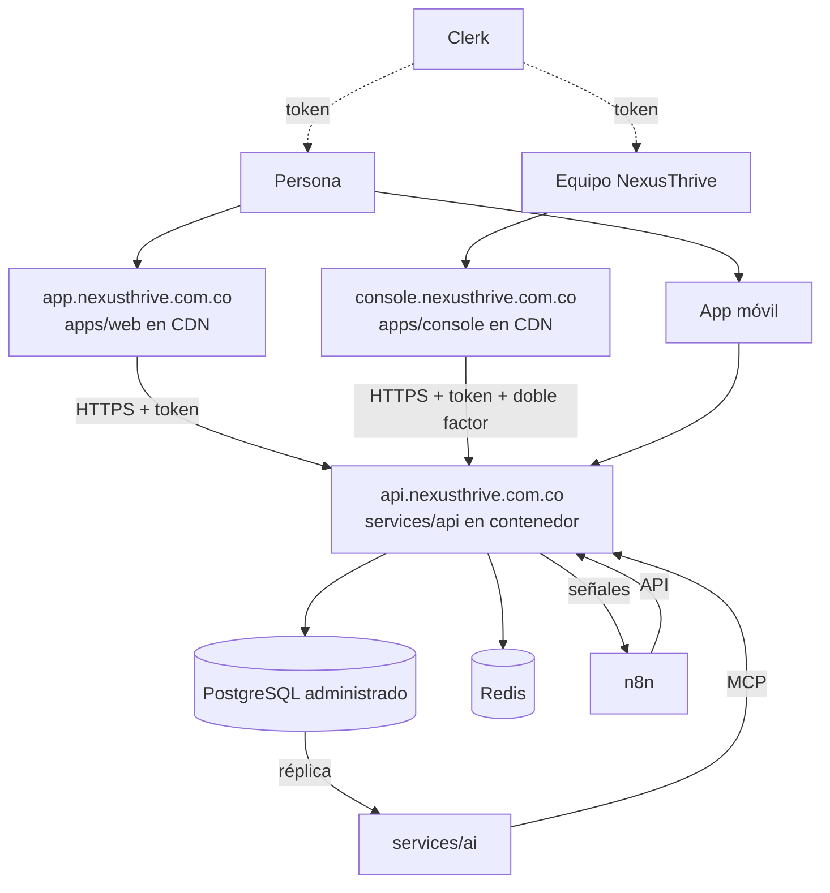

# Despliegue

## Propósito

Definir dónde corre cada pieza en producción.

## Alcance

Entornos `staging` y `production`, según [ADR-0019](../05-decisiones/0019-alojamiento-y-entornos.md) y las URLs de [ADR-0023](../05-decisiones/0023-urls-y-dominios.md). El entorno local está en [`07-ingenieria/development-setup.md`](../07-ingenieria/development-setup.md).

## Funcionamiento

| Pieza | Dónde | Notas |
|---|---|---|
| `apps/web`, `apps/console` | Vercel | Solo archivos estáticos; la consola en un subdominio propio |
| `services/api` | Staging: servidor propio con Dokploy. Production: Render | Una sola imagen; único con acceso a la base |
| PostgreSQL | Supabase, un proyecto por entorno | Solo como Postgres: sin Data API ni Supabase Auth; copias en production |
| Redis | Administrado | Caché y sesiones |
| `services/ai` | Contenedor aparte | Lee la réplica |
| n8n | Servidor propio con Dokploy | Una instancia con credenciales separadas por entorno; solo habla con la API |
| `apps/mobile` | App Store y Google Play con Expo | |
| `apps/desktop` | Instaladores Tauri | |

## Reglas e invariantes

- Tres entornos: `local`, `staging` y `production`, con bases separadas.
- Los secretos viven en el gestor del proveedor, nunca en el repositorio.
