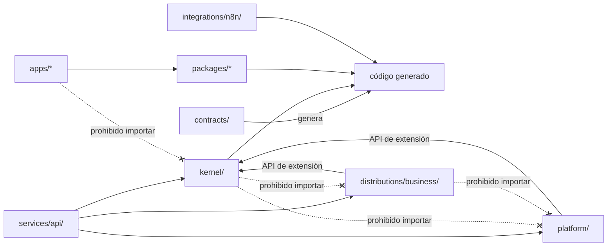
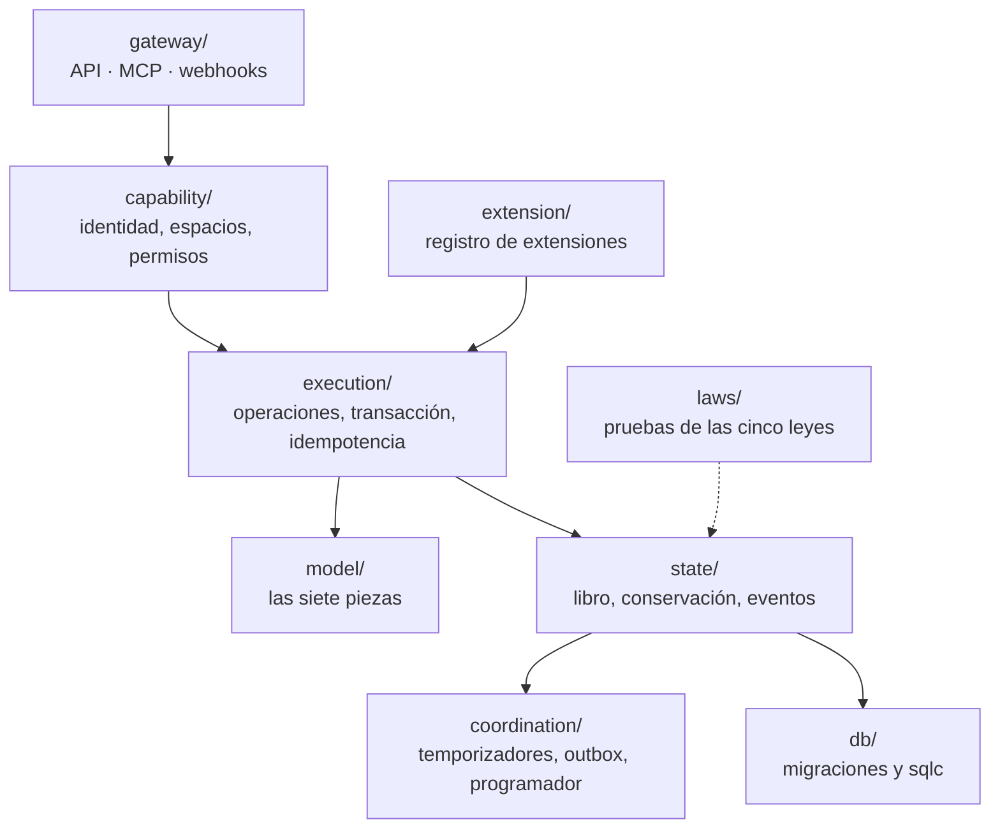
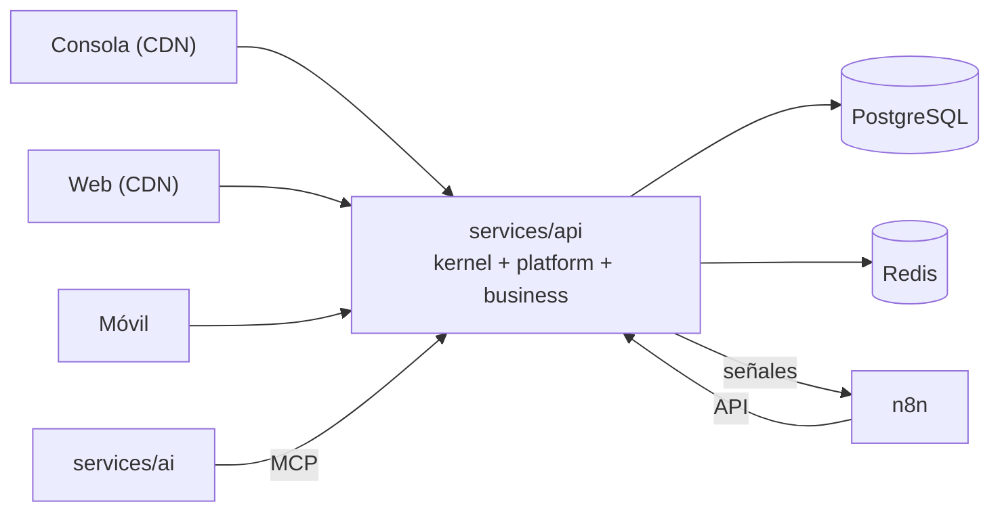

# Estructura del monorepo

## Propósito

Definir dónde vive cada pieza del código y qué dependencias están permitidas.

## Alcance

Incluye las carpetas raíz, su contenido, su lenguaje y sus reglas de dependencia.

## Conceptos principales

```
nexusthrive/
├── README.md               resumen (español)
├── AGENTS.md               guía para agentes de código (inglés)
├── CLAUDE.md               importa AGENTS.md
├── CONTRIBUTING.md         cómo contribuir (inglés)
├── CHANGELOG.md            cambios por versión (inglés)
│
├── kernel/                 Go · el núcleo
├── platform/               Go · la capa por encima de todo
├── distributions/
│   └── business/           Go + YAML · Thrive Business
├── services/
│   ├── api/                Go · el binario que une kernel, plataforma y distribuciones
│   └── ai/                 Python · análisis e IA
├── apps/
│   ├── console/            React · consola NexusThrive
│   ├── web/                React · app de los negocios
│   ├── mobile/             Expo · recepción
│   └── desktop/            Tauri · escritorio
├── packages/
│   ├── ui/                 componentes (Tailwind + Storybook)
│   ├── app/                lógica de pantallas compartida
│   ├── sdk/                cliente generado desde contracts
│   ├── i18n/               textos por idioma
│   └── config/             tsconfig, ESLint y Tailwind compartidos
├── contracts/              Protobuf + JSON Schema · fuente única
├── integrations/n8n/       nodo y flujos de n8n
├── infra/                  Docker local y despliegue
├── tools/                  utilidades del repositorio
├── docs/                   documentación (español)
├── .github/                plantillas y CI (inglés)
├── go.work                 módulos Go
├── package.json            raíz pnpm + Turborepo
├── pnpm-workspace.yaml
├── turbo.json
└── Taskfile.yml            comandos comunes: task dev, task test, task gen
```

## Funcionamiento

### Quién puede depender de quién



- `services/api` es el único lugar que conoce a todos: arma el binario.
- `platform/` y las distribuciones nunca se importan entre sí; si necesitan algo común, va al kernel o al contrato.
- Las apps solo hablan con el backend por red, usando `@nexusthrive/sdk`.

### Por dentro del kernel



### Qué corre en producción



## Reglas e invariantes

1. Cada carpeta compila, se prueba y se despliega sola; el CI solo corre lo que cambió.
2. Nombres de archivos y carpetas de código en inglés; `docs/` en español.
3. Nada generado se edita a mano (`packages/sdk`, `kernel/gen`).

## Decisiones relacionadas

- [ADR-0003 · Monorepo](../05-decisiones/0003-monorepo.md)
- [ADR-0004 · Contrato único](../05-decisiones/0004-contrato-unico.md)
