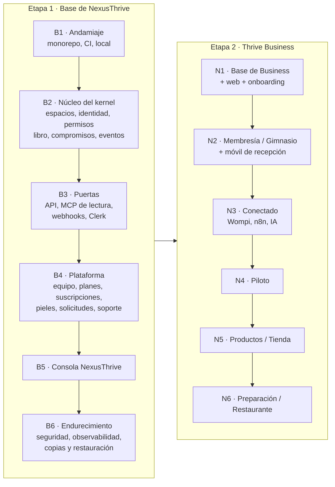

# Hoja de ruta

## Propósito

Fijar el orden de construcción: primero la base de NexusThrive, después Thrive Business.

## Alcance

Las dos etapas y sus fases, con el criterio que dice cuándo cada una está terminada.

## Funcionamiento

| Fase | Terminada cuando |
|---|---|
| B1 | `task setup`, `task test` y `task lint` funcionan en una máquina limpia; el CI corre solo lo que cambió |
| B2 | Las cinco leyes tienen pruebas en verde; un intercambio y un compromiso de prueba se escriben en una transacción con su evento y su outbox |
| B3 | Una operación entra por la API con token de Clerk, se ejecuta, se repite con la misma clave sin duplicarse y su señal llega a un webhook firmado |
| B4 | La plataforma crea un espacio en prueba con su suscripción, publica una piel de prueba y procesa una solicitud de capacidad de punta a punta |
| B5 | El equipo opera desde la consola: crea negocios, confirma cobros, decide solicitudes, abre accesos de soporte auditados y reintenta tareas fallidas |
| B6 | Pruebas de aislamiento entre espacios, doble factor obligatorio para el equipo, métricas y alertas, y una restauración de copia probada |
| N1 a N6 | Ver [MVP de Business](../03-distribuciones/business/mvp/README.md) |

## Reglas e invariantes

- No empieza la etapa 2 hasta terminar B5. B6 puede avanzar en paralelo con N1.
- Una fase no está terminada mientras su criterio no se cumpla con pruebas automáticas.
