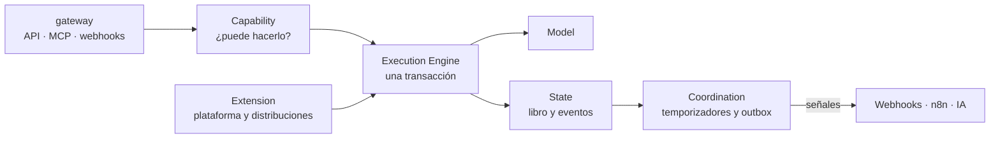

# Kernel

## Propósito

Explicar qué hace el kernel por dentro: cómo recibe, autoriza, ejecuta, guarda y anuncia cada operación.

## Alcance

Los seis componentes del kernel y el camino de una operación. El modelo de datos está en [modelo-de-datos/kernel.md](modelo-de-datos/kernel.md).

## Conceptos principales

El kernel tiene seis componentes. Son responsabilidades, no servicios separados: corren en un solo binario de Go.

| Componente | Paquete | Responsabilidad | Nunca hace |
|---|---|---|---|
| `Model` | `model/` | Define participantes, recursos, intercambios y compromisos | Saber de rubros |
| `State` | `state/` | Guarda el presente y la memoria; aplica la conservación | Borrar historia |
| `Capability` | `capability/` | Decide quién puede hacer qué: personas, integraciones y agentes | Ejecutar acciones |
| `Coordination` | `coordination/` | Vigila el tiempo, despierta compromisos, despacha señales | Mover valor por su cuenta |
| `Execution Engine` | `execution/` | Corre cada operación autorizada en una transacción | Saltarse el permiso |
| `Extension` | `extension/` | Registra la plataforma y las distribuciones | Modificar el núcleo |

Las puertas (`gateway/`) traducen HTTP, MCP y webhooks al motor de operaciones.

## Funcionamiento

El camino de toda operación, venga de una cara, de la consola, de una IA o de n8n:

1. Entra por una **puerta** con un token o una llave.
2. La puerta resuelve identidad, espacio y participante y arma el `Actor`; el permiso y la capacidad activa los verifica `Capability` dentro de la transacción del motor, antes de cualquier escritura ([ADR-0032](../05-decisiones/0032-catalogo-de-permisos-y-verificacion.md), [ADR-0035](../05-decisiones/0035-motor-de-ejecucion.md)).
3. La **extensión** dueña de la operación la traduce a piezas del kernel.
4. `Execution Engine` abre una transacción, verifica el permiso y ejecuta. Una operación idempotente entra por `RunIdempotent`: con la clave y la huella de la solicitud, devuelve la respuesta guardada o ejecuta y guarda su registro en la misma transacción ([ADR-0026](../05-decisiones/0026-idempotencia-por-registro.md)).
5. `State` escribe intercambios, compromisos, eventos y outbox en esa misma transacción.
6. `Coordination` programa temporizadores y despacha las señales cuando la transacción confirma.

Si cualquier paso falla, no queda nada a medias.

## Permisos y verificación

`capability/` verifica dentro de la transacción que ya fijó el espacio (`state.InSpace`), con la misma RLS que la operación. No recibe un espacio aparte: el espacio es el de la transacción, y sin espacio fijado todo es `permission_denied`. El catálogo mínimo tiene 13 claves con su riesgo (`read`, `write`, `money`) y vive en `model.KernelCatalog()`; las distribuciones lo amplían con `Extend`, que nunca admite el espacio de nombres `kernel`.

`Check` evalúa en este orden y corta en el primer fallo:

| Paso | Falla con | Error |
|---|---|---|
| 1. Actor nulo, mal formado o no resoluble (también si la clave es desconocida) | Un anónimo no obtiene información | `permission_denied` |
| 2. Clave de permiso o de capacidad fuera del catálogo o mal formada | Error de código | `invalid_input` |
| 3. Sin grant vigente (vencido, revocado o participante archivado) | Mensaje único | `permission_denied` |
| 4. Espacio `suspended` o `closed` y permiso `write` o `money` | `provisioning` cuenta como `active` | `space_suspended` |
| 5. Capacidad declarada que no está `active` | | `capability_inactive` |

El actor `system` salta solo el paso 3. Para `write` y `money`, `Check` toma `FOR SHARE` sobre los grants leídos y sobre la fila del espacio: una revocación o suspensión concurrente espera a que termine la transacción. Las funciones `CheckRoleCreatable`, `CheckGrantable`, `CheckRevocable` y `CheckCapabilityEnable` aplican las reglas de escalada del ADR-0029; las operaciones que gestionan roles, grants y capacidades las llamarán cuando pasen por el motor (hoy el motor no las expone).

**Límite de confianza en M1:** el actor lo afirma la capa de aplicación. `Check` prueba que ese participante tiene permiso, no que quien llama sea ese participante; la puerta de B3 construye el `Actor` solo desde un token validado. Un espacio `closed` es terminal (disparador) y `kernel.capability.write` solo existe en espacios `platform` (disparador): ver [modelo de datos](modelo-de-datos/kernel.md).

## Motor de ejecución

`execution.Engine` es el único camino de producción para escribir. Una operación se declara en Go (`execution.Operation`): nombre con espacio de nombres, lista de permisos (se verifica cada clave), capacidad opcional, riesgo (igual al mayor de sus permisos) e idempotencia (obligatoria si el riesgo es `money`). `NewEngine` valida todas al arrancar y se niega a registrar una declaración inválida: nombre repetido o con prefijo `kernel.`, permiso fuera del catálogo, riesgo menor que el de sus permisos o dinero sin idempotencia.

`Run` valida la llamada (identificador de solicitud acotado, operación registrada, espacio UUID no nulo), abre la transacción con el espacio fijado, convierte en solo lectura las operaciones `read`, verifica cada permiso con `Authorizer.Check` **en esa misma transacción y antes de escribir** (sus bloqueos duran hasta el `COMMIT`: una revocación o suspensión concurrente espera) y entrega al manejador una `Tx` mínima. La `Tx` no expone SQL: solo `RecordExchange`, `CreateCommitment`, `AppendEvent` (con su outbox) y `ReadEvents`, cada una condicionada a que la operación haya declarado su permiso y al espacio de nombres de la operación (una extensión no puede escribir `kernel.commitment.expired`). El actor y el `request_id` salen de la llamada: el evento los lleva, y el outbox cuelga del evento por `event_seq`. Una `Tx` usada tras terminar devuelve `rule_violation`.

Si el manejador falla o entra en pánico, la transacción se deshace: un pánico sale como `*PanicError` sin tipo (su mensaje solo nombra la operación) (B3 lo traduce a una respuesta genérica sin mensaje). Un error de base que el manejador trague no confirma. Los fallos de las restricciones diferidas al `COMMIT` salen como `rule_violation`; un privilegio faltante (`42501`) nunca se disfraza. No hay reintentos.

**Idempotencia.** Una operación declarada `Idempotent` (obligatorio para `money`) corre solo por `Engine.RunIdempotent`; `Run` la rechaza con `invalid_input`. La llamada trae `IdempotencyKey` (`^[A-Za-z0-9._:-]{1,128}$`) y `Request` (el cuerpo recibido: lo llenará B3; el motor calcula la huella y no lo guarda). Antes de abrir nada se validan la clave y el cuerpo canónico (`invalid_input`); dentro de la transacción se verifican los permisos y solo después se toma el bloqueo asesor de (espacio, clave) hasta el `COMMIT`. Con un registro vigente: la misma huella (operación, actor y cuerpo canónico) devuelve la respuesta guardada, byte a byte, sin correr el manejador (`Replayed`); otra huella devuelve `idempotency_conflict` sin escribir. Sin registro, corre el manejador (`ResultHandler`, que devuelve un objeto JSON de hasta 64 KiB) y guarda el registro en la misma transacción; un fallo, un pánico o un `COMMIT` fallido no dejan registro y la misma clave se puede reintentar. El registro vence a las 24 horas; se lee con el menor de los relojes (inyectable y de la base) y se escribe con `created_at` dentro de una ventana de 5 minutos antes de `now()` de la base. Un reloj en cero o atrasado más de esa tolerancia hace fallar la operación con `invalid_input` antes de ejecutar el manejador; el motor exige además el nivel `READ COMMITTED`. Tras el vencimiento la ejecución nueva inserta la generación siguiente, sin `UPDATE` ni `DELETE`. El motor deriva la clave de cada intercambio (`<ejecución>:<n>`) y la `Tx` rechaza la que traiga el manejador (enmienda del [ADR-0030](../05-decisiones/0030-libro-de-doble-partida.md)).

Las operaciones del propio kernel son `kernel.timer.fire` y `kernel.outbox.claim` (ambas `write`: un espacio suspendido las pausa). Solo se llaman por `Engine.FireDueTimers` y `Engine.ClaimOutbox` con un manejador fijado por el motor: `Run` rechaza con `invalid_input` cualquier nombre del espacio de nombres `kernel`.

**Límite y precondiciones de B3.** El motor es código: quien tenga el pool puede saltárselo. En M1 solo el kernel lo tiene, y una prueba de arquitectura impide que algo fuera de `kernel/state` y `kernel/execution` importe `kernel/state`. Las puertas y extensiones de B3 reciben solo el `Engine`, construyen el `Actor` solo desde un token validado (nunca `ActorSystem` desde una petición) y no exponen `ClaimOutbox`, `MarkOutboxSent` ni `MarkOutboxFailed`. Detalle en [ADR-0035](../05-decisiones/0035-motor-de-ejecucion.md).

## Compromisos

Un compromiso es una obligación de un deudor a un acreedor sobre un recurso, con monto y vencimiento obligatorio. El kernel, no quien llama, deriva su estado (`open`, `fulfilled`, `canceled`, `expired`), el monto cumplido y la hora de cierre; el rol de la API solo inserta compromisos abiertos. Se cumple con asientos del libro: cada cumplimiento aplica un asiento positivo de una cuenta del acreedor, una sola vez y completo, y `state.AppendFulfillment` bloquea la fila del compromiso (`FOR NO KEY UPDATE`) para que dos cumplimientos concurrentes nunca superen el monto. Cancelar exige un motivo y solo es posible mientras el compromiso está abierto. Los cumplimientos son de solo agregar y los compromisos no se borran. El vencimiento se describe en la sección siguiente. Detalle en [modelo de datos](modelo-de-datos/kernel.md) y [ADR-0033](../05-decisiones/0033-compromisos-estado-derivado-y-asiento-unico.md).

## Temporizadores y vencimiento

Cada compromiso tiene un timer de vencimiento que la base crea con el compromiso, mueve al reprogramar `due_at` (solo hacia el futuro, con `state.RescheduleCommitment`) y cancela al cumplir o cancelar. Un compromiso solo llega a `expired` cuando su timer vence según el reloj de la base: `state.FireDueTimers` (una transacción) bloquea los compromisos candidatos (`FOR NO KEY UPDATE SKIP LOCKED`, sin arrendamiento: reclamar y disparar son uno), dispara los timers vencidos, deja el compromiso `expired` y escribe el evento `kernel.commitment.expired` v1 y su fila de outbox para el suscriptor `internal`. El reloj inyectable solo puede ir por detrás del de la base. En producción el camino es `execution.Engine.FireDueTimers` (operación `kernel.timer.fire`): verifica `kernel.timer.process` con `Authorizer.Check` en la misma transacción, exige el actor `system` y se pausa en un espacio suspendido. Detalle y garantías en [ADR-0034](../05-decisiones/0034-vencimiento-de-compromisos-por-timer.md).

**Estado hoy: en producción nada dispara timers.** Falta el proceso programador: un proceso periódico en `services/api` que recorra los espacios activos (el despacho entre espacios que decidirá el ADR del seguimiento 39), llame por espacio a `FireDueTimers` con `model.SystemClock` y el actor `system`, registre `scheduler_runs` y no se exponga por B3. Hasta entonces un compromiso vencido sigue `open`; llega con el programador (M4 o antes). Tampoco hay recordatorios previos al vencimiento, reintentos ni evento de reprogramación (seguimiento 60).

## Reglas e invariantes

- Las cinco [leyes](../01-modelo/leyes.md) tienen pruebas en `kernel/laws/` que nunca se desactivan.
- Una prueba de arquitectura falla si aparece vocabulario de una distribución dentro de `kernel/`.
- `kernel/` no importa `platform/` ni `distributions/`; ellas se registran en `extension/`.

## Ejemplo

El componente de ejecución procesa operaciones autorizadas. Cada operación se ejecuta dentro de una transacción para evitar que el estado quede parcialmente actualizado. Antes de ejecutarla, el kernel valida la identidad, las capacidades y las reglas correspondientes.

## Decisiones relacionadas

- [ADR-0001 · El kernel no conoce ningún mundo](../05-decisiones/0001-kernel-sin-mundo.md)
- [ADR-0009 · Libro de movimientos de doble partida](../05-decisiones/0009-libro-de-movimientos.md)
- [ADR-0032 · Catálogo de permisos y verificación](../05-decisiones/0032-catalogo-de-permisos-y-verificacion.md)
- [ADR-0026 · Idempotencia por registro](../05-decisiones/0026-idempotencia-por-registro.md)
- [ADR-0035 · Motor de ejecución](../05-decisiones/0035-motor-de-ejecucion.md)
