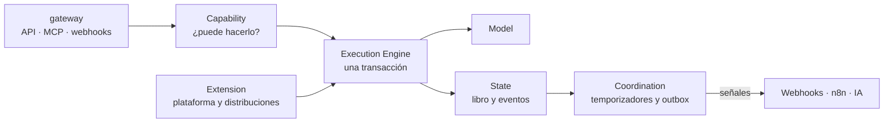

# Kernel

## Propósito

Explicar qué hace el kernel por dentro: cómo recibe, autoriza, ejecuta, guarda y anuncia cada operación.

## Alcance

Los seis componentes del kernel y el camino de una operación. El modelo de datos está en [modelo-de-datos/kernel.md](modelo-de-datos/kernel.md).

## Conceptos principales

El kernel tiene seis componentes. Son responsabilidades, no servicios separados: corren en un solo binario de Go.

| Componente | Paquete | Responsabilidad | Nunca hace |
|---|---|---|---|
| `Model` | `model/` | Define participantes, recursos, intercambios y compromisos | Saber de rubros |
| `State` | `state/` | Guarda el presente y la memoria; aplica la conservación | Borrar historia |
| `Capability` | `capability/` | Decide quién puede hacer qué: personas, integraciones y agentes | Ejecutar acciones |
| `Coordination` | `coordination/` | Vigila el tiempo, despierta compromisos, despacha señales | Mover valor por su cuenta |
| `Execution Engine` | `execution/` | Corre cada operación autorizada en una transacción | Saltarse el permiso |
| `Extension` | `extension/` | Registra la plataforma y las distribuciones | Modificar el núcleo |

Las puertas (`gateway/`) traducen HTTP, MCP y webhooks al motor de operaciones.

## Funcionamiento

El camino de toda operación, venga de una cara, de la consola, de una IA o de n8n:

1. Entra por una **puerta** con un token o una llave.
2. `Capability` resuelve identidad, espacio y participante, y verifica permiso y capacidad activa.
3. La **extensión** dueña de la operación la traduce a piezas del kernel.
4. `Execution Engine` abre una transacción, revisa la idempotencia y ejecuta.
5. `State` escribe intercambios, compromisos, eventos y outbox en esa misma transacción.
6. `Coordination` programa temporizadores y despacha las señales cuando la transacción confirma.

Si cualquier paso falla, no queda nada a medias.

## Reglas e invariantes

- Las cinco [leyes](../01-modelo/leyes.md) tienen pruebas en `kernel/laws/` que nunca se desactivan.
- Una prueba de arquitectura falla si aparece vocabulario de una distribución dentro de `kernel/`.
- `kernel/` no importa `platform/` ni `distributions/`; ellas se registran en `extension/`.

## Ejemplo

El componente de ejecución procesa operaciones autorizadas. Cada operación se ejecuta dentro de una transacción para evitar que el estado quede parcialmente actualizado. Antes de ejecutarla, el kernel valida la identidad, las capacidades y las reglas correspondientes.

## Decisiones relacionadas

- [ADR-0001 · El kernel no conoce ningún mundo](../05-decisiones/0001-kernel-sin-mundo.md)
- [ADR-0009 · Libro de movimientos de doble partida](../05-decisiones/0009-libro-de-movimientos.md)
