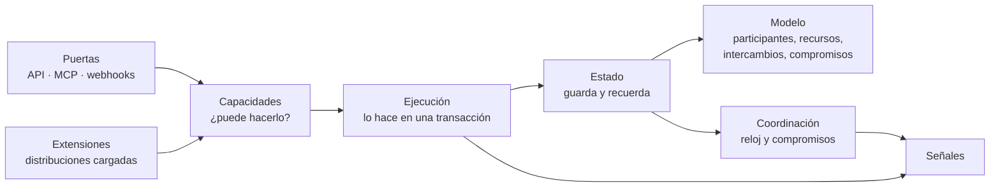

# El kernel

El kernel tiene seis componentes. Son responsabilidades, no seis servicios: corren en un solo binario de Go.



| Componente | Responsabilidad | Nunca hace |
|---|---|---|
| **Modelo** | Define participantes, recursos, intercambios, compromisos y cómo se relacionan | Saber de rubros |
| **Estado** | Guarda el presente y la memoria; aplica la ley de conservación | Borrar historia |
| **Capacidades** | Decide quién puede hacer qué: personas, integraciones y agentes de IA | Ejecutar acciones |
| **Coordinación** | Vigila el tiempo, despierta compromisos, ordena dependencias | Mover valor por su cuenta |
| **Ejecución** | Corre cada operación autorizada en una transacción y registra sus consecuencias | Saltarse el permiso |
| **Extensiones** | Carga distribuciones, sus traductores, sus operaciones y su configuración | Modificar el núcleo |

## El camino de una operación

Toda acción, venga de la web, de una IA o de n8n, sigue el mismo camino:

1. Entra por una **puerta**.
2. **Capacidades** verifica identidad, participante, permiso y que la función esté activa.
3. La **extensión** de la distribución traduce la intención a piezas del kernel.
4. **Ejecución** la corre en una sola transacción.
5. **Estado** la guarda y emite la **señal** en la misma transacción.
6. **Coordinación** agenda lo que el tiempo deba despertar después.

Si cualquier paso falla, no queda nada a medias.

## Organización del código

```
kernel/
├── cmd/kernel/          punto de entrada del binario
├── model/               las siete piezas
├── state/               persistencia, conservación, eventos
├── capability/          identidad, permisos, alcances
├── coordination/        reloj, compromisos, outbox
├── execution/           motor de operaciones e idempotencia
├── extension/           carga de distribuciones
├── gateway/             API (Connect), MCP, webhooks
└── laws/                pruebas de las cinco leyes
```
