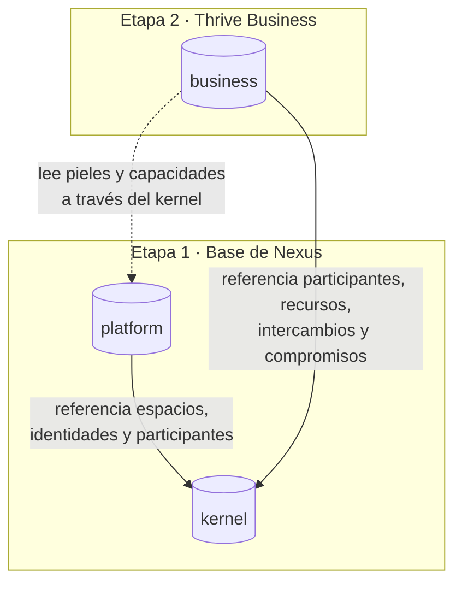

# Modelo de datos

## Propósito

Definir cómo se guarda la información de NexusThrive en PostgreSQL y qué capa es dueña de cada tabla.

## Alcance

Incluye los tres esquemas de la base de datos y sus reglas comunes. El detalle de cada esquema está en su propia página.

## Conceptos principales

La base de datos tiene un esquema por capa. Cada capa solo escribe en su esquema; las capas superiores **referencian** al kernel, nunca lo duplican.

| Esquema | Dueño | Contenido | Etapa |
|---|---|---|---|
| [`kernel`](kernel.md) | `kernel/` | Espacios, identidades, participantes, permisos, libro de movimientos, compromisos, tiempo, eventos y señales | 1 · Base |
| [`platform`](plataforma.md) | `platform/` | Equipo NexusThrive, planes, suscripciones, cobros, pieles, solicitudes, soporte y prospectos | 1 · Base |
| [`business`](business.md) | `distributions/business/` | Clientes, catálogo, ventas, cartera, caja, documentos y patrones | 2 · Business |

## Reglas e invariantes

1. **Nombres en inglés y en plural:** `spaces`, `participants`, `memberships`. Columnas en `snake_case`.
2. **Identificadores `uuid` v7** (ordenables por tiempo), salvo `kernel.events.seq`, que es secuencial.
3. **Toda tabla de datos de un espacio lleva `space_id`** y toda consulta filtra por él. Se refuerza con políticas de seguridad por fila (RLS) en PostgreSQL.
4. **Dinero en `numeric(20,6)`**, nunca en coma flotante. La moneda se guarda en el recurso, no en cada fila.
5. **Fechas en `timestamptz` (UTC).** La zona horaria del espacio se usa solo para mostrar y para calcular días de negocio.
6. **Solo agregar:** `kernel.events`, `kernel.entries` y `kernel.fulfillments` nunca se actualizan ni se borran.
7. **Sin duplicar estado:** saldos, cartera y caja se derivan del libro de movimientos. Si una proyección existe por rendimiento, se actualiza en la misma transacción.
8. **Una capa nunca escribe en el esquema de otra.** `business` pide al kernel crear intercambios y compromisos mediante su API de extensión.
9. **Borrado lógico** (`archived_at`, `revoked_at`, `closed_at`) para datos con historia; borrado físico solo por solicitud de eliminación de datos personales, registrada en auditoría.

## Decisiones relacionadas

- [ADR-0009 · Libro de movimientos de doble partida](../../05-decisiones/0009-libro-de-movimientos.md)
- [ADR-0010 · Un esquema por capa](../../05-decisiones/0010-esquemas-por-capa.md)
