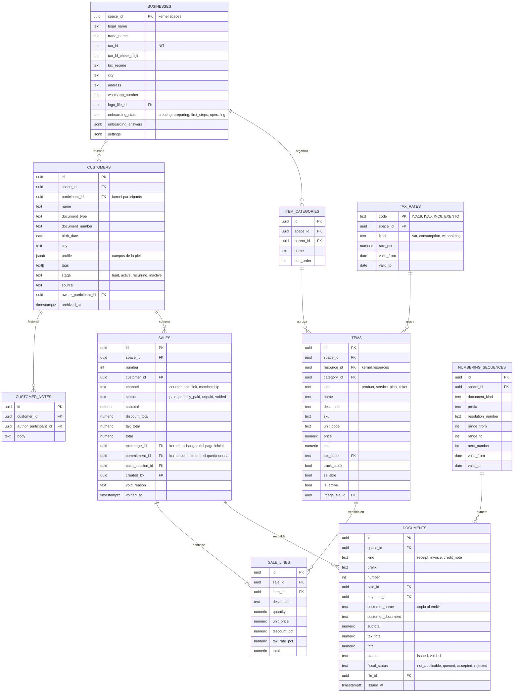
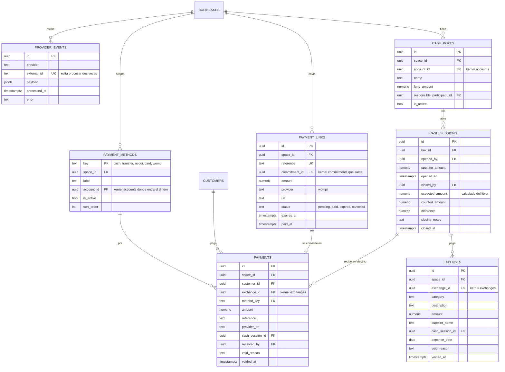

# Esquema `business`

## Propósito

Guardar el idioma de los negocios (clientes, catálogo, ventas, cartera, caja, documentos y patrones) apuntando siempre a las piezas del kernel.

## Alcance

Corresponde a la **etapa 2**: se construye después de terminar el kernel y la plataforma. Incluye la base de Business y el patrón Membresía. Los patrones Productos y Preparación se agregan después.

## Conceptos principales

Cada tabla de Business tiene una columna que la conecta con el kernel. El dinero, las deudas y las existencias nunca se guardan aquí: se leen del libro de movimientos.

| Business | Kernel |
|---|---|
| `businesses` | `spaces` de tipo `business` |
| `customers`, empleados | `participants` |
| `items` (producto, servicio, plan) | `resources` |
| `payment_methods`, `cash_boxes` | `accounts` |
| Venta pagada, pago, gasto | `exchanges` + `entries` |
| Venta a crédito, deuda | `commitments` de dinero |
| `memberships` | `commitments` de acceso |

## 1. Clientes, catálogo y ventas

## 2. Cobros y caja

## 3. Patrón Membresía

```mermaid
erDiagram
    ITEMS ||--o| PLANS : "es un"
    PLANS ||--o{ MEMBERSHIPS : "se asigna como"
    CUSTOMERS ||--o{ MEMBERSHIPS : "tiene"
    MEMBERSHIPS ||--o{ MEMBERSHIP_FREEZES : "se congela"
    CUSTOMERS ||--o{ ACCESS_CREDENTIALS : "usa"
    CUSTOMERS ||--o{ CHECKINS : "entra"
    MEMBERSHIPS ||--o{ CHECKINS : "autoriza"
    DEVICES ||--o{ CHECKINS : "registra"

    PLANS {
        uuid item_id PK "items de tipo plan"
        int duration_days
        int freeze_max_days
        jsonb access_rules "días y horarios permitidos"
        text renewal_mode "manual, reminder"
    }
    MEMBERSHIPS {
        uuid id PK
        uuid space_id FK
        uuid customer_id FK
        uuid plan_id FK
        uuid commitment_id FK "kernel.commitments de acceso"
        uuid sale_id FK
        date starts_on
        date ends_on
        numeric price
        text status "upcoming, active, frozen, expired, canceled"
        text cancel_reason
        timestamptz canceled_at
    }
    MEMBERSHIP_FREEZES {
        uuid id PK
        uuid membership_id FK
        date frozen_from
        date frozen_until
        uuid requested_by FK
    }
    ACCESS_CREDENTIALS {
        uuid id PK
        uuid space_id FK
        uuid customer_id FK
        text kind "qr, nfc, document"
        text code "único por espacio"
        timestamptz issued_at
        timestamptz revoked_at
    }
    CHECKINS {
        uuid id PK
        uuid space_id FK
        uuid customer_id FK "nulo si el código no existe"
        uuid membership_id FK
        uuid credential_id FK
        uuid device_id FK
        text method "qr, nfc, document, manual"
        text scanned_value
        bool allowed
        text reason "expired, frozen, not_started, unknown"
        uuid recorded_by FK
        timestamptz at
    }
    DEVICES {
        uuid id PK
        uuid space_id FK
        text name
        text kind "reception_mobile"
        timestamptz last_sync_at
    }
```

## Reglas e invariantes

- **Una venta, una forma:** POS, enlace, membresía y mostrador crean `sales` con la misma operación.
- **La membresía se cobra con ventas:** nunca tiene su propio dinero; su `sale_id` apunta a la venta.
- **Caja cuadrada:** `expected_amount` se calcula de las entradas del libro en la cuenta de la caja durante la sesión.
- **Documentos inmutables:** un documento emitido se anula con nota crédito; nunca se edita.
- **Pagos externos una sola vez:** `provider_events.external_id` es único.
- **Entradas siempre registradas:** permitidas, rechazadas y códigos desconocidos.

## Fuera de esta etapa

Variantes, bodegas y existencias (patrón Productos), mesas y comandas (patrón Preparación), compras y proveedores, contabilidad completa y facturación electrónica. Cada uno tendrá su sección cuando entre a construcción.
