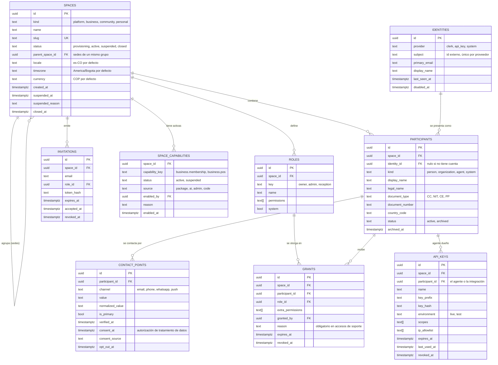
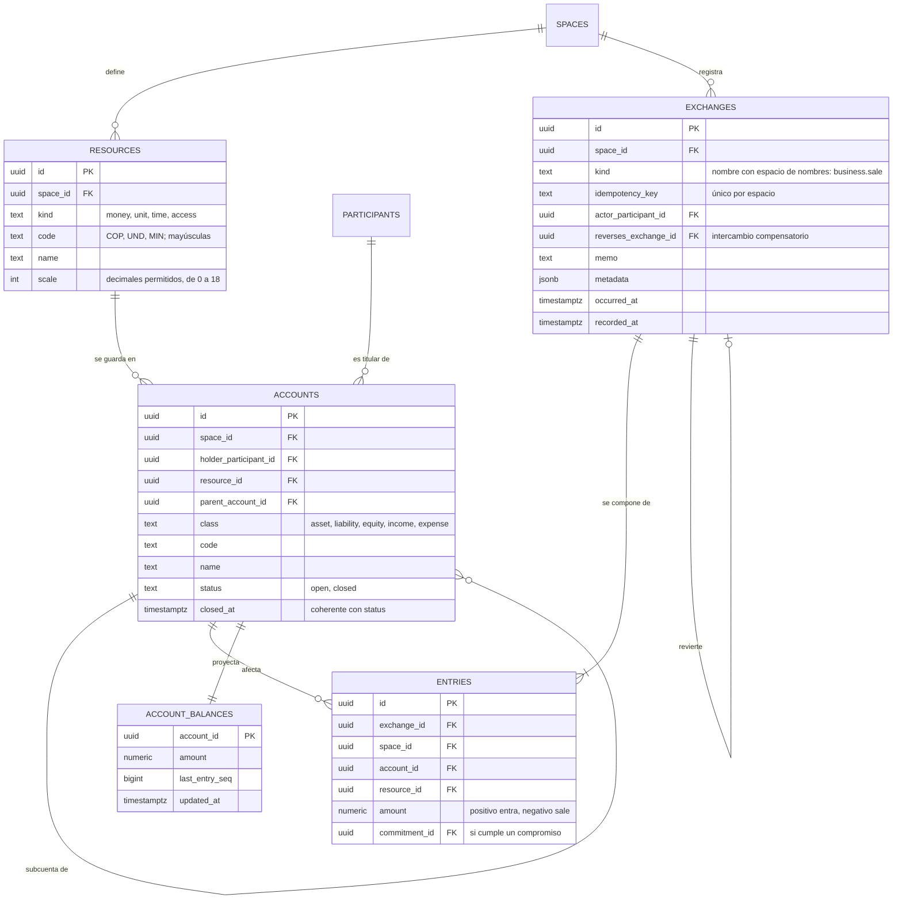
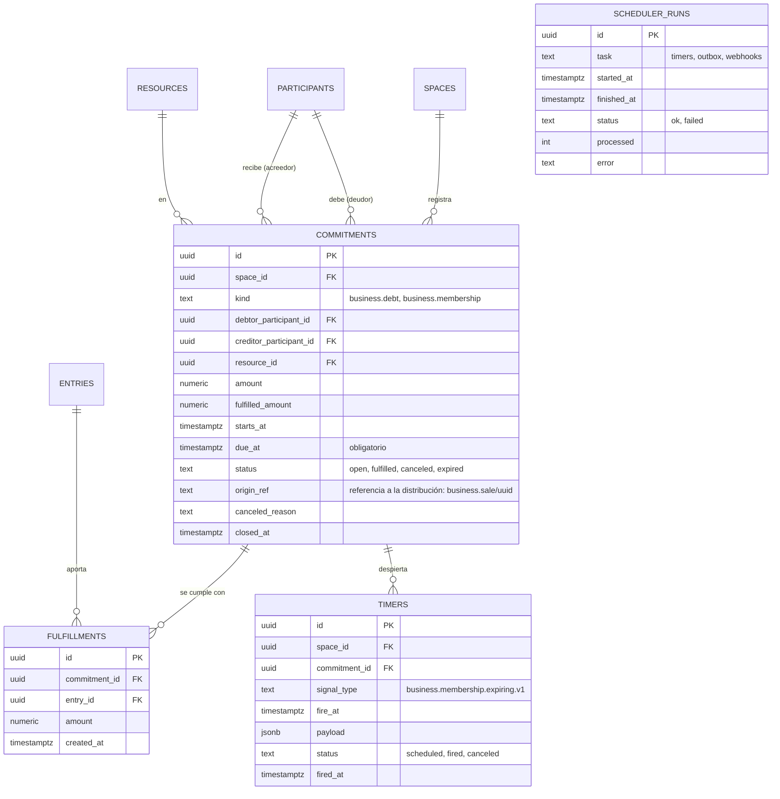
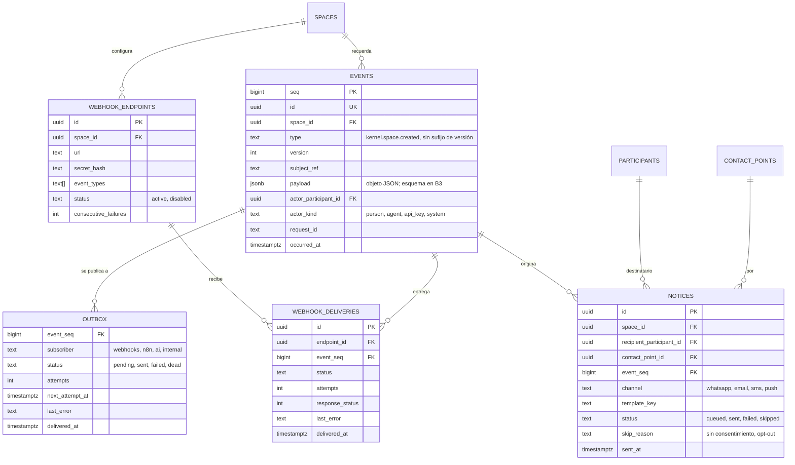

# Esquema `kernel`

## Propósito

Guardar las siete piezas del modelo universal de forma que se cumplan las cinco leyes, sin conocer ningún mundo.

## Alcance

Incluye identidad y acceso, el libro de movimientos, los compromisos y el tiempo, la memoria y las señales, y el soporte operativo. No incluye nada del equipo NexusThrive (esquema `platform`) ni de ninguna distribución.

## Conceptos principales

| Pieza del modelo | Tablas |
|---|---|
| Participante | `identities`, `participants`, `contact_points` |
| Regla | `roles`, `grants`, `invitations`, `api_keys`, `space_capabilities` |
| Recurso | `resources`, `accounts` |
| Intercambio | `exchanges`, `entries` |
| Compromiso | `commitments`, `fulfillments` |
| Tiempo | `timers`, `scheduler_runs` |
| Evento | `events`, `outbox`, `webhook_endpoints`, `webhook_deliveries`, `notices` |

Un **espacio** (`space`) es la unidad de aislamiento: un negocio, una comunidad o una persona. El equipo NexusThrive vive en un espacio de tipo `platform`.

Una **identidad** es alguien que puede iniciar sesión (persona con Clerk, agente con llave). Un **participante** es esa identidad, o alguien sin cuenta, dentro de un espacio concreto. Una persona con tres negocios tiene una identidad y tres participantes.

## 1. Identidad y acceso

## 2. Libro de movimientos

Todo valor que se mueve, sea dinero, unidades de inventario, tiempo o acceso, pasa por aquí. Una **cuenta** es un lugar donde un participante guarda un recurso; un **intercambio** mueve recursos entre cuentas con **asientos** que suman cero por recurso.

## 3. Compromisos y tiempo

## 4. Memoria y señales

## 5. Soporte operativo

| Tabla | Para qué |
|---|---|
| `idempotency_records` | Guarda la respuesta de cada operación por `space_id` + clave durante 24 horas; una repetición devuelve la misma respuesta |
| `usage_counters` | Consumo por espacio, medidor y periodo (usuarios, participantes, llamadas a la API, acciones de IA) contra el límite del plan |
| `access_audit` | Toda lectura o escritura hecha por un actor privilegiado (soporte, agentes) con motivo y `request_id` |
| `files` | Archivos (logos, comprobantes, documentos) con `sha256`, tipo y tamaño; el contenido vive en almacenamiento de objetos |

## Reglas e invariantes

- **Conservación:** un disparador diferido verifica que `sum(entries.amount)` por `(exchange_id, resource_id)` sea cero al confirmar la transacción.
- **Memoria:** `events`, `entries` y `fulfillments` no admiten `UPDATE` ni `DELETE`; un error se corrige con un intercambio cuyo `reverses_exchange_id` apunta al original.
- **Eventos:** `type` son dos o más segmentos en minúsculas separados por punto (`kernel.space.created`) y no lleva sufijo de versión, porque la versión es la columna `version`. `payload` es un objeto JSON; su validación con JSON Schema llega en B3. `seq` es `GENERATED ALWAYS`: único, creciente por orden de asignación, con huecos tras un rollback, y no es el orden de confirmación (ADR-0028). Una lectura "desde `seq = n`" es inclusiva y devuelve solo eventos confirmados del espacio actual en orden ascendente; el consumidor guarda como cursor el último `seq` más uno, reanuda con traslape y deduplica por `id`. Un evento sin actor se rechaza, salvo `actor_kind = system`; el actor, si es un participante, debe pertenecer al mismo espacio (clave foránea compuesta `(actor_participant_id, space_id)` hacia `participants (id, space_id)`).
- **Inmutabilidad de eventos:** dos capas. El rol de la API tiene `SELECT` sobre la tabla e `INSERT` solo por columnas (todas menos `seq`, así que tampoco puede fijarlo con `OVERRIDING SYSTEM VALUE` ni con `COPY`), y la RLS solo tiene políticas `SELECT` e `INSERT`. Además, un disparador por fila (`UPDATE`, `DELETE`) y otro por sentencia (`TRUNCATE`) llaman a `kernel.reject_event_change()`, que falla con `restrict_violation` incluso para el dueño y el administrador, y aunque un permiso se conceda por error. Un superusuario puede deshabilitar el disparador con DDL deliberado (ADR-0028).
- **Recursos y cuentas:** `resources.code` va en mayúsculas (`^[A-Z][A-Z0-9_]{0,31}$`), es único por `(space_id, code)` y `scale` es un entero de 0 a 18. El recurso es inmutable para la API (sin `UPDATE`): cambiar `scale` o `kind` con asientos corrompería el libro. `accounts.name` y `accounts.code` son obligatorios y el código es único por `(space_id, holder_participant_id, code)`. `closed_at` es obligatorio si y solo si `status = closed`. Toda referencia a datos de espacio es una clave foránea compuesta con `space_id`, porque la comprobación de claves ignora la RLS: `(holder_participant_id, space_id)` hacia `participants`, `(resource_id, space_id)` hacia `resources` y `(parent_account_id, space_id, resource_id)` hacia `accounts`, de modo que la cuenta madre comparte espacio y recurso. Una cuenta nace abierta (la API no tiene `INSERT` sobre `status` ni `closed_at`), pasa una sola vez de `open` a `closed` y no se reabre: un disparador por fila (`kernel.reject_account_reopen()`, `restrict_violation`) lo impide incluso al dueño. Los asientos referenciarán `accounts (id, space_id, resource_id)` y un disparador de `entries` rechazará las cuentas cerradas bajo `FOR SHARE` (HU-kernel-exchanges-08).
- **Compromiso:** `due_at` y `status` son obligatorios; `fulfilled_amount` nunca supera `amount`.
- **Permiso:** toda fila escrita tiene un actor (`actor_participant_id` o equivalente); no existen escrituras anónimas.
- **Movimiento:** al crear o modificar un compromiso con vencimiento se crea o reprograma su `timer` en la misma transacción.
- **Aislamiento:** RLS por `space_id` en todas las tablas con datos de espacio, con `ENABLE` y `FORCE`. La política compara con `kernel.current_space_id()`, que lee el parámetro `kernel.space_id` fijado por transacción (`set_config(..., true)`, equivalente a `SET LOCAL`); sin valor no hay filas ni error. En `spaces` la política compara `id`. La API se conecta como `nexusthrive_api`, un rol sin superusuario, sin `BYPASSRLS` y sin ser dueño de objetos (ADR-0027). La función fija su `search_path` (`pg_catalog, pg_temp`) y una migración rechaza el rol si tiene `SUPERUSER`, `BYPASSRLS`, `CREATEROLE`, `CREATEDB` o `REPLICATION`. `identities` no tiene `space_id`: una política `SELECT` la muestra solo si existe un participante suyo en el espacio actual, y una política `INSERT` permite crearla antes de que tenga participante; la API no puede actualizarla ni borrarla. En `participants`, `UPDATE` se limita a `status` y `archived_at`, y un índice único parcial `(space_id, identity_id)` donde `identity_id` no es nulo garantiza un participante por identidad en cada espacio.

## Ejemplo

Un socio paga 50.000 COP en efectivo de un plan de 100.000; queda debiendo 50.000:

| Tabla | Filas |
|---|---|
| `commitments` | Deuda de 100.000 COP, deudor el socio, acreedor el negocio, vence en 5 días |
| `exchanges` | `business.payment`, idempotente por la clave de la recepción |
| `entries` | +50.000 en la cuenta caja del negocio · −50.000 en la cuenta por cobrar del socio |
| `fulfillments` | 50.000 aplicados a la deuda (`fulfilled_amount` = 50.000) |
| `timers` | Señal `debt.overdue` en 5 días |
| `events` + `outbox` | `business.payment.received` (versión 1) pendiente para n8n |

## Decisiones relacionadas

- [ADR-0001 · El kernel no conoce ningún mundo](../../05-decisiones/0001-kernel-sin-mundo.md)
- [ADR-0009 · Libro de movimientos de doble partida](../../05-decisiones/0009-libro-de-movimientos.md)
