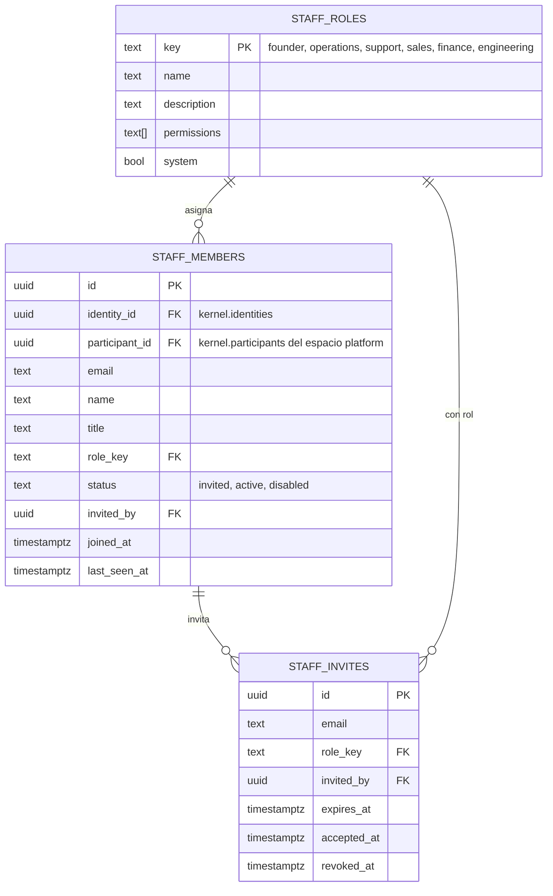
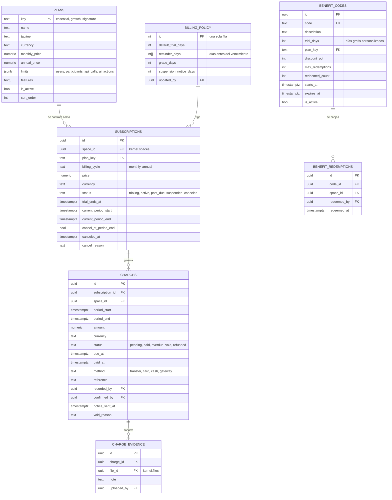
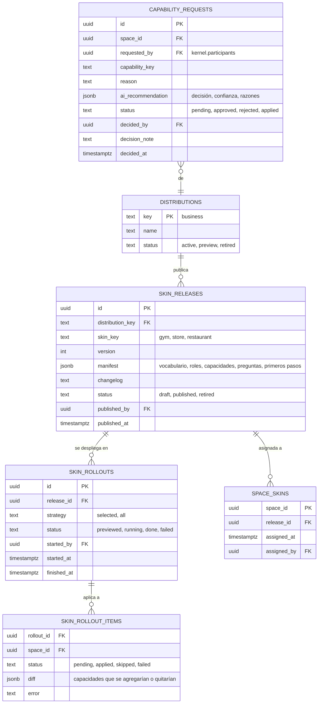
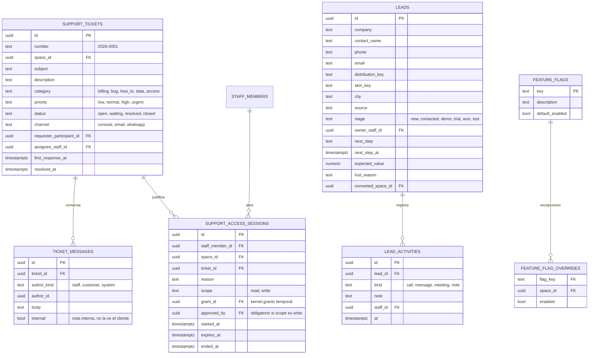

# Esquema `platform`

## Propósito

Guardar todo lo que NexusThrive necesita para operar como empresa por encima de todos los espacios: su equipo, lo que cobra, lo que publica, lo que aprueba y cómo da soporte.

## Alcance

Incluye equipo y permisos internos, planes y suscripciones, cobros, pruebas y códigos, distribuciones y pieles, solicitudes de capacidades, soporte, prospectos y banderas de funciones. Lo usa la [consola NexusThrive](../plataforma/consola.md). No guarda datos operativos de ningún negocio.

## Conceptos principales

- El equipo NexusThrive son participantes del **espacio `platform`** del kernel; `staff_members` agrega lo que solo aplica al equipo.
- Una **suscripción** une un espacio con un plan. Los **cobros** son lo que NexusThrive le cobra a ese espacio cada periodo.
- Una **piel** se publica como una **versión** (`skin_releases`). Un **despliegue** (`skin_rollouts`) la aplica a los espacios.
- Un **acceso de soporte** crea un `grant` temporal en el espacio del cliente, con motivo, y todo lo que se hace queda en `kernel.access_audit`.

## 1. Equipo NexusThrive

## 2. Planes, suscripciones y cobros

## 3. Distribuciones, pieles y solicitudes

## 4. Soporte, prospectos y banderas

Además, `identity_limits` guarda cuántos espacios puede crear una identidad (por defecto, uno en autoservicio).

## Reglas e invariantes

- Un espacio de tipo distinto a `platform` tiene **exactamente una** suscripción vigente.
- Un cobro pagado **no se edita**: se anula con motivo y se crea otro.
- Una versión de piel publicada **no cambia**: se publica una versión nueva.
- Un despliegue de piel **solo toca** capacidades con `source = package`; nunca las que vienen de `ai`, `admin` o `code`.
- Un acceso de soporte con alcance `write` requiere aprobación de un segundo miembro del equipo y expira solo.
- Ninguna tabla de `platform` guarda clientes, ventas ni dinero de un negocio.

## Decisiones relacionadas

- [ADR-0011 · La plataforma por encima de los espacios](../../05-decisiones/0011-plataforma-por-encima.md)
- [ADR-0015 · Pieles versionadas con despliegue controlado](../../05-decisiones/0015-pieles-versionadas.md)
