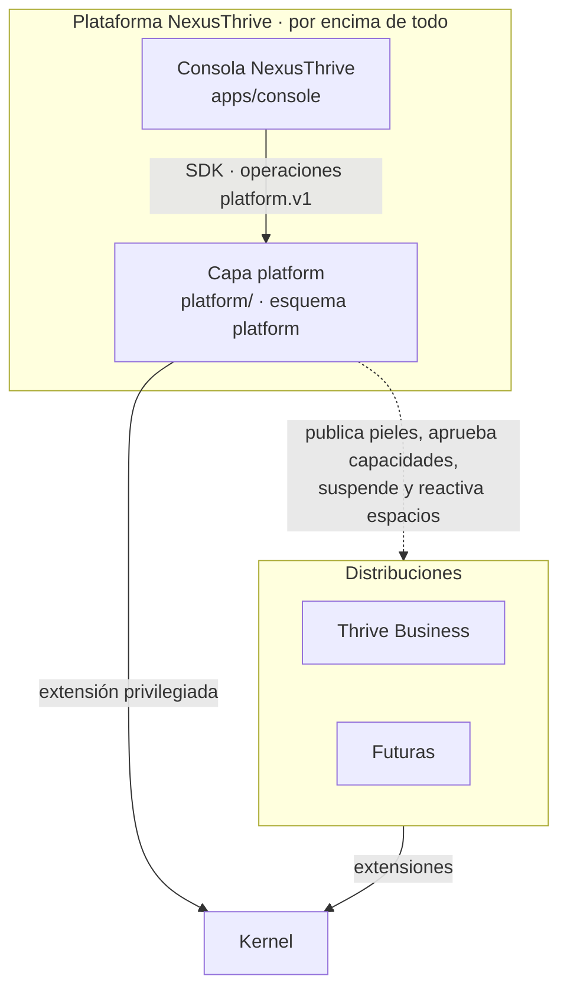

# Plataforma NexusThrive

## Propósito

Describir la capa que está **por encima de todo NexusThrive**: la que usa el equipo NexusThrive para crear, cobrar, configurar, vigilar y dar soporte a todos los espacios.

## Alcance

Incluye la capa `platform/` (Go), su esquema de datos y la consola (`apps/console`). No incluye las pantallas que usan los negocios.

## Conceptos principales

- **La plataforma es una extensión privilegiada del kernel.** Corre dentro del mismo binario y usa las mismas leyes, pero sus operaciones pueden actuar sobre varios espacios.
- **El equipo NexusThrive vive en el espacio `platform`.** Sus permisos se resuelven igual que los de cualquier participante, con roles propios.
- **Nada privilegiado es invisible.** Todo acceso a un espacio ajeno es temporal, tiene motivo y queda en auditoría.

## Funcionamiento

| Responsabilidad | Dónde |
|---|---|
| Qué ve y hace el equipo | [consola.md](consola.md) |
| Cómo funcionan sus procesos | [flujos.md](flujos.md) |
| Cómo se protege | [seguridad.md](seguridad.md) |
| Qué guarda | [../modelo-de-datos/plataforma.md](../modelo-de-datos/plataforma.md) |

## Reglas e invariantes

1. La consola solo la usa el equipo NexusThrive; ningún cliente entra a ella.
2. La plataforma nunca escribe datos operativos de un negocio (ventas, clientes, caja). Para corregir algo, abre un acceso de soporte y actúa con las operaciones normales de la distribución.
3. Toda acción de la consola es una operación del contrato `platform.v1`, con permiso, auditoría y evento.

## Decisiones relacionadas

- [ADR-0011 · La plataforma por encima de los espacios](../../05-decisiones/0011-plataforma-por-encima.md)
