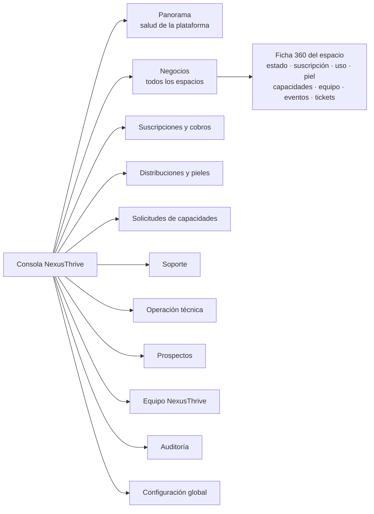
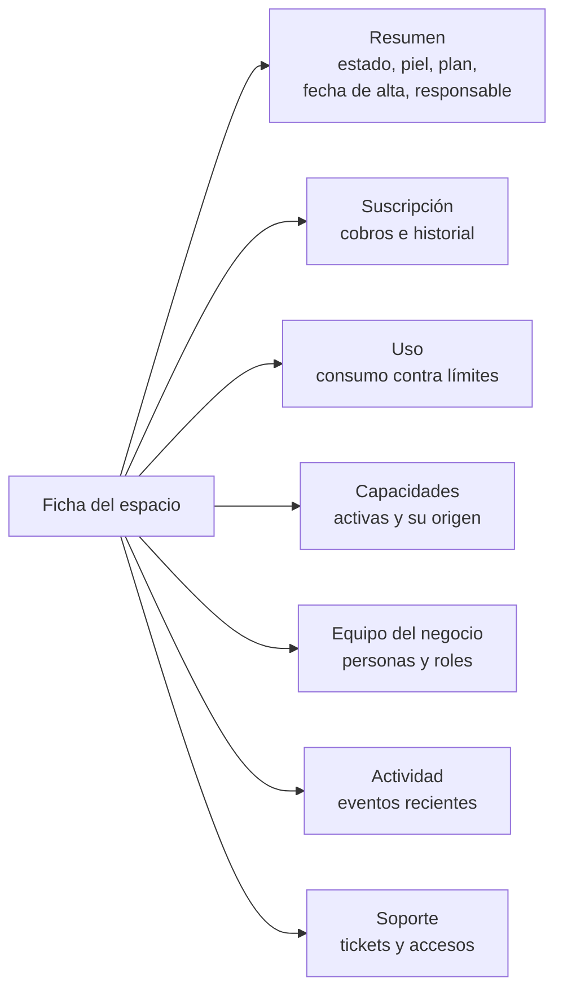

# Consola NexusThrive

## Propósito

Definir el panel principal de NexusThrive: dónde el equipo ve el estado de toda la plataforma y opera sobre cualquier espacio, con permisos y auditoría.

## Alcance

Incluye los módulos de la consola, qué muestra cada uno, quién puede usarlo y qué operaciones dispara. El diseño visual se hace sobre `@nexusthrive/ui`.

## Conceptos principales

### Mapa de la consola

### Módulos

| Módulo | Qué muestra | Qué permite |
|---|---|---|
| **Panorama** | Espacios activos, en prueba, suspendidos; ingreso mensual recurrente; cobros vencidos; solicitudes pendientes; tareas fallidas; tickets abiertos | Ir a lo urgente en un clic |
| **Negocios** | Lista con filtros por estado, piel, plan, ciudad y salud; ficha 360 de cada espacio | Crear un negocio en prueba, cambiar plan, extender prueba, suspender, reactivar, cerrar |
| **Suscripciones y cobros** | Suscripciones por estado, cobros del periodo, morosos, conciliación | Registrar y confirmar pagos con evidencia, anular, reembolsar, editar la política de cobranza, crear códigos de beneficio y días de prueba |
| **Distribuciones y pieles** | Distribuciones activas, versiones de cada piel y sus diferencias | Crear borrador, publicar versión, simular un despliegue, desplegar a espacios seleccionados o a todos |
| **Solicitudes de capacidades** | Cola con la recomendación de la IA y el contexto del espacio | Aprobar, rechazar o pedir más información |
| **Soporte** | Tickets por prioridad y estado, tiempos de primera respuesta | Responder, asignar, abrir acceso de soporte auditado |
| **Operación técnica** | Outbox pendiente y fallido, temporizadores, ejecuciones del programador, webhooks deshabilitados, avisos fallidos | Reintentar, descartar con motivo, reactivar un endpoint |
| **Prospectos** | Embudo de ventas de NexusThrive | Registrar actividad, convertir en negocio en prueba |
| **Equipo NexusThrive** | Miembros, roles e invitaciones | Invitar, cambiar rol, desactivar |
| **Auditoría** | Todo lo hecho desde la consola y todo acceso a espacios ajenos | Filtrar por persona, espacio, acción y fecha; exportar |
| **Configuración global** | Planes, banderas de funciones, política de cobranza | Editar con registro de quién y cuándo |

### Ficha 360 de un espacio

La ficha **no muestra** clientes, ventas ni montos del negocio. Para verlos se abre un acceso de soporte.

## Funcionamiento

### Roles del equipo NexusThrive

| Permiso | Fundador | Operaciones | Soporte | Finanzas | Ventas | Ingeniería |
|---|---|---|---|---|---|---|
| Ver negocios (`spaces.read`) | sí | sí | sí | sí | sí | sí |
| Crear negocio en prueba (`spaces.create`) | sí | sí | — | — | sí | — |
| Suspender y reactivar (`spaces.suspend`) | sí | sí | — | sí | — | — |
| Cerrar un espacio (`spaces.close`) | sí | — | — | — | — | — |
| Cobros y suscripciones (`billing.manage`) | sí | — | — | sí | — | — |
| Planes y códigos (`plans.manage`) | sí | — | — | sí | — | — |
| Borradores de pieles (`skins.draft`) | sí | sí | — | — | — | sí |
| Publicar y desplegar pieles (`skins.publish`) | sí | sí | — | — | — | — |
| Decidir solicitudes (`requests.decide`) | sí | sí | — | — | — | — |
| Tickets (`support.tickets`) | sí | sí | sí | sí | — | sí |
| Acceso de lectura a un espacio (`support.access.read`) | sí | sí | sí | — | — | sí |
| Aprobar acceso de escritura (`support.access.approve`) | sí | sí | — | — | — | — |
| Prospectos (`leads.manage`) | sí | — | — | — | sí | — |
| Operación técnica (`ops.manage`) | sí | — | — | — | — | sí |
| Banderas de funciones (`flags.manage`) | sí | — | — | — | — | sí |
| Equipo NexusThrive (`staff.manage`) | sí | — | — | — | — | — |
| Auditoría (`audit.read`) | sí | sí | — | sí | — | sí |

### Operaciones del contrato `platform.v1`

| Grupo | Operaciones |
|---|---|
| Espacios | `spaces.List`, `spaces.Get`, `spaces.CreateTrial`, `spaces.Suspend`, `spaces.Reactivate`, `spaces.Close` |
| Suscripciones | `subscriptions.ChangePlan`, `subscriptions.ExtendTrial`, `charges.Record`, `charges.Confirm`, `charges.Void`, `charges.Refund` |
| Configuración comercial | `plans.Upsert`, `benefitCodes.Create`, `billingPolicy.Update` |
| Pieles | `skins.CreateDraft`, `skins.Publish`, `rollouts.Preview`, `rollouts.Start` |
| Solicitudes | `capabilityRequests.List`, `capabilityRequests.Decide` |
| Soporte | `tickets.*`, `supportAccess.Open`, `supportAccess.Approve`, `supportAccess.End` |
| Operación | `ops.ListFailures`, `ops.Retry`, `ops.Discard`, `webhooks.Reenable` |
| Equipo y gobierno | `staff.Invite`, `staff.SetRole`, `staff.Disable`, `flags.Set`, `audit.Search` |

## Reglas e invariantes

- Toda pantalla de la consola filtra por los permisos del rol; un botón sin permiso no se muestra **y** la operación lo rechaza.
- Toda acción destructiva (suspender, cerrar, anular, reembolsar) pide motivo y confirmación.
- El panorama se calcula con datos de `platform` y métricas del kernel; nunca lee datos operativos de un negocio.

## Ejemplo

Finanzas ve en el panorama tres cobros vencidos. Abre el primero, ve que el gimnasio envió el comprobante por WhatsApp, lo sube como evidencia y confirma el pago. La suscripción vuelve a `active`, el kernel emite `platform.charge.confirmed.v1` y el dueño recibe su recibo.

## Decisiones relacionadas

- [ADR-0011 · La plataforma por encima de los espacios](../../05-decisiones/0011-plataforma-por-encima.md)
- [ADR-0007 · El dueño no activa funciones](../../05-decisiones/0007-configura-nexusthrive.md)
