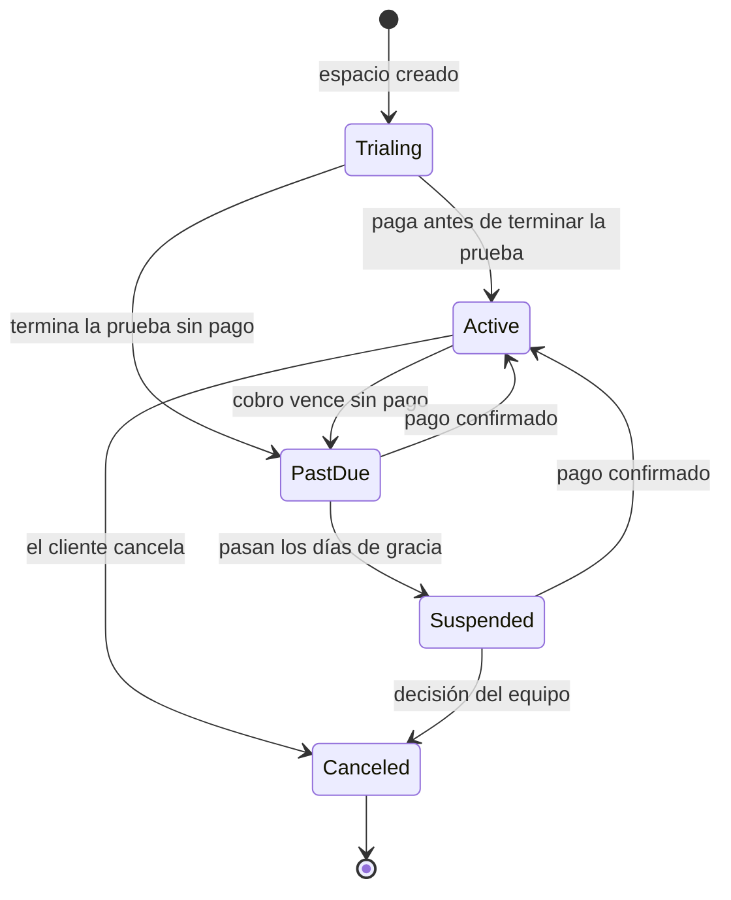
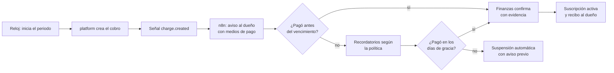
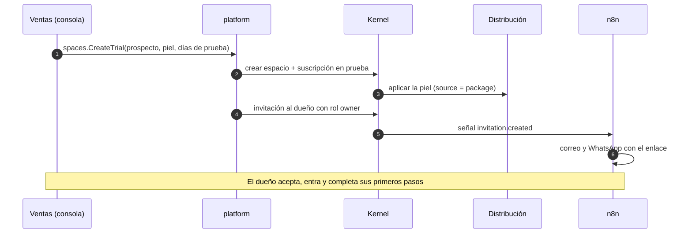
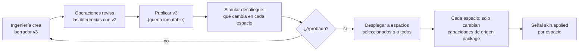
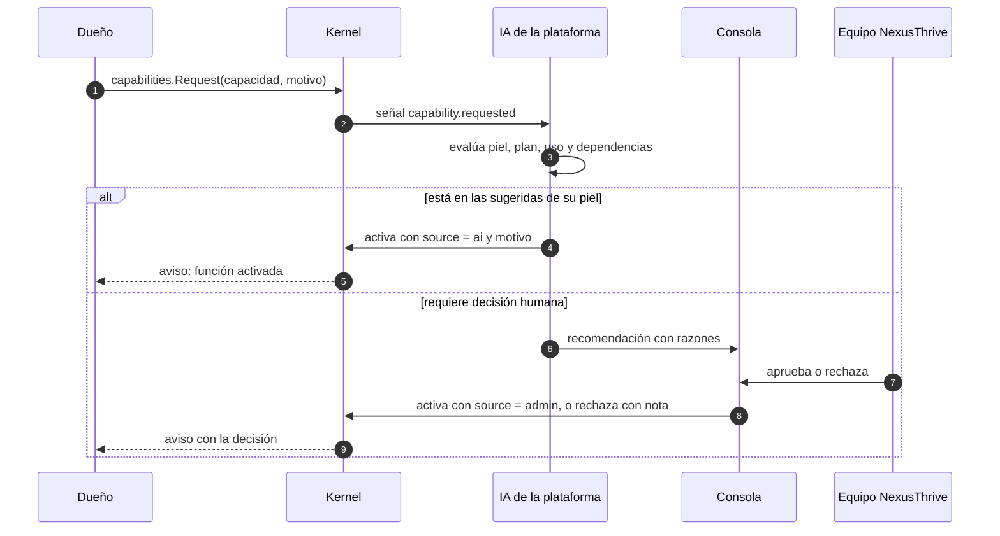
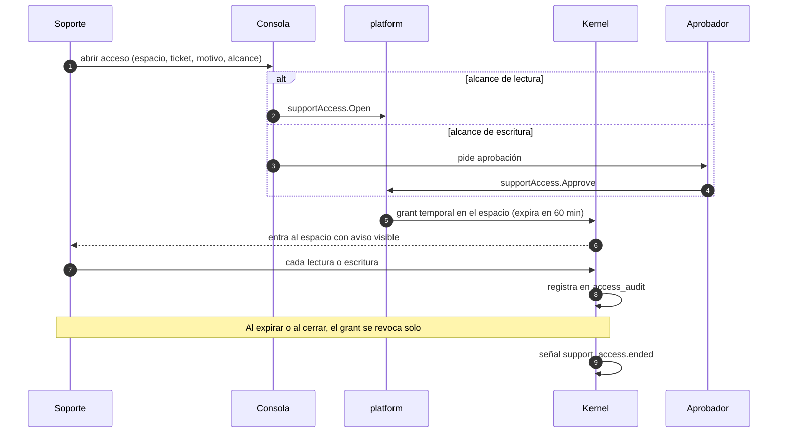
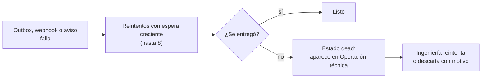

# Flujos de la plataforma

## Propósito

Describir los procesos que la plataforma ejecuta sobre los espacios: suscripción y cobranza, pieles, solicitudes, soporte y operación técnica.

## Alcance

Incluye los flujos que inicia el equipo NexusThrive o el reloj del kernel. Los flujos de uso diario de un negocio están en su distribución.

## Funcionamiento

### 1. Ciclo de una suscripción

| Estado | Qué puede hacer el negocio |
|---|---|
| `trialing`, `active` | Todo lo que permite su plan |
| `past_due` | Todo, con aviso permanente de pago pendiente |
| `suspended` | Ver y exportar sus datos; no registra operaciones nuevas |
| `canceled` | Exportar durante 30 días; después se archiva |

### 2. Cobranza mensual

### 3. Crear un negocio desde la consola

Para ventas asistidas: el equipo crea el negocio y el dueño solo lo recibe.

### 4. Publicar y desplegar una piel

### 5. Solicitud de una capacidad

### 6. Acceso de soporte auditado

El dueño del negocio ve en su historial que hubo un acceso de soporte, quién, cuándo y por qué.

### 7. Suspender y reactivar

| Efecto de `spaces.Suspend` | Detalle |
|---|---|
| Caras | Mensaje de cuenta suspendida; ver y exportar siguen disponibles |
| Operaciones | Toda escritura responde `space_suspended` |
| Páginas y enlaces públicos | Muestran "no disponible"; los enlaces de pago no aceptan cobros nuevos |
| Webhooks entrantes | Se guardan sin procesar |
| Outbox y temporizadores | Se pausan para ese espacio |
| API y MCP | Responden `space_suspended` en escrituras |

Al reactivar, lo guardado se procesa en orden y los temporizadores vencidos se disparan una sola vez.

### 8. Tareas fallidas

## Decisiones relacionadas

- [ADR-0011 · La plataforma por encima de los espacios](../../05-decisiones/0011-plataforma-por-encima.md)
- [ADR-0015 · Pieles versionadas con despliegue controlado](../../05-decisiones/0015-pieles-versionadas.md)
