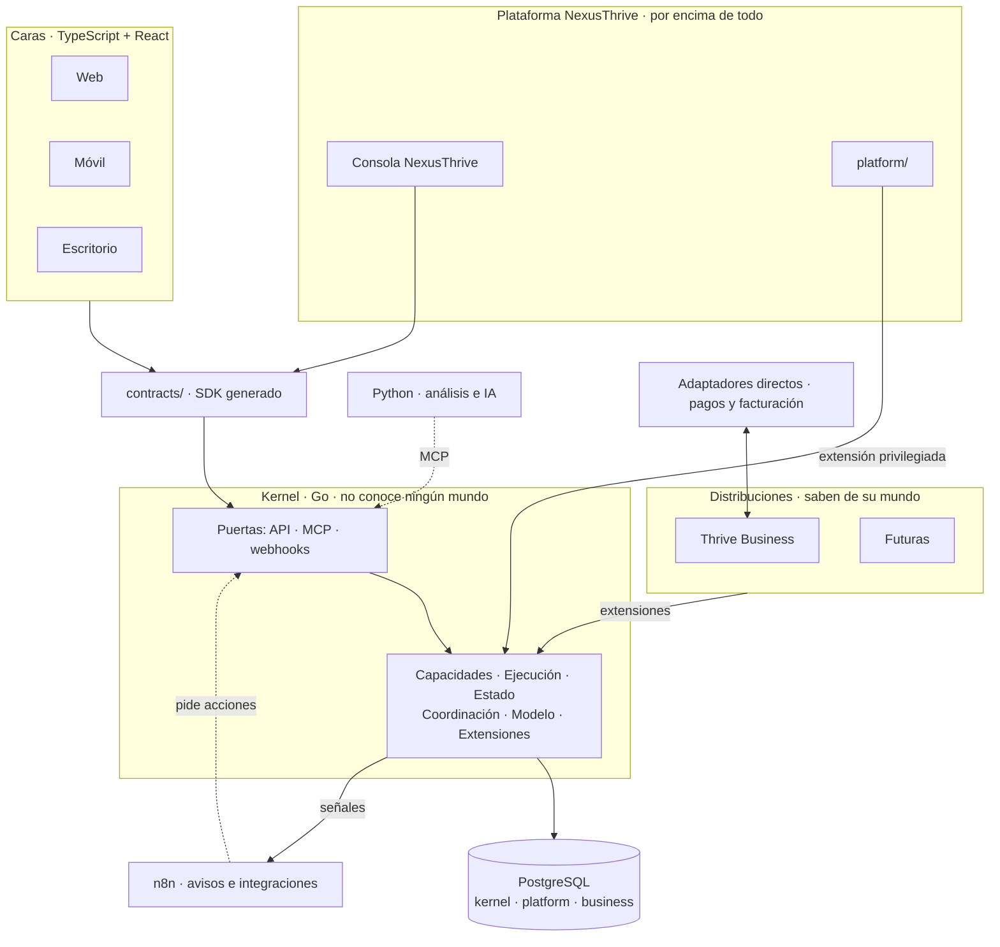

# Visión general

## Propósito

Mostrar las capas de NexusThrive y cómo se comunican.

## Alcance

Vista de alto nivel. El detalle de cada capa está en su propia página.

## Conceptos principales

NexusThrive tiene una capa por encima de todo (la plataforma), un núcleo (el kernel), mundos encima del núcleo (las distribuciones) y las caras que usa la gente.

## Funcionamiento

1. **Caras y consola** muestran y piden. No tienen lógica. Todas usan el mismo SDK.
2. **Puertas** reciben cada petición y la entregan al motor de operaciones.
3. **Kernel** verifica permisos, ejecuta en una sola transacción, guarda y emite señales.
4. **Plataforma** y **distribuciones** son extensiones que corren dentro del mismo proceso que el kernel. Registran sus operaciones y traducen su idioma a las piezas del kernel.
5. **n8n** escucha señales y conecta con el mundo exterior. **Python** analiza y actúa por MCP.

## Reglas e invariantes

1. Nadie toca la base de datos sino el kernel y sus extensiones.
2. Ninguna pieza importa código de otra: todo cruza por `contracts/`.
3. El kernel no conoce ningún mundo; si aparece la palabra "factura" en `kernel/`, algo está mal.
4. La plataforma actúa sobre varios espacios solo con permisos propios y auditoría.

## Decisiones relacionadas

- [ADR-0001 · El kernel no conoce ningún mundo](../05-decisiones/0001-kernel-sin-mundo.md)
- [ADR-0011 · La plataforma por encima de los espacios](../05-decisiones/0011-plataforma-por-encima.md)
