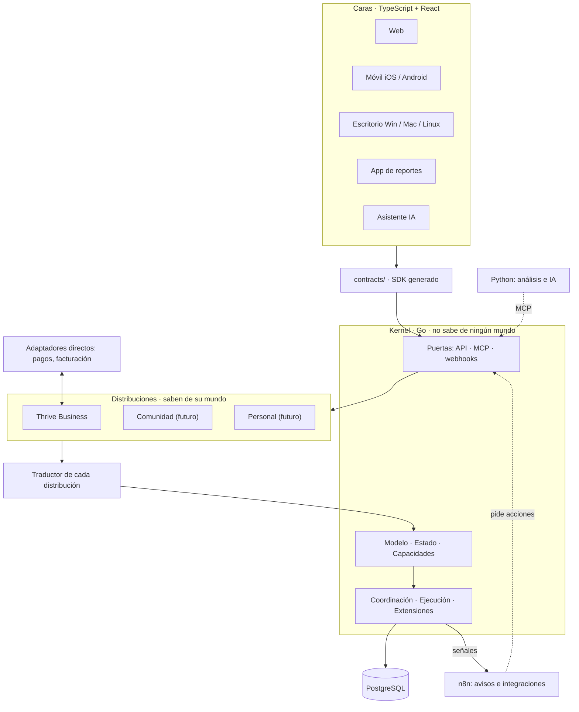

# Visión general

NexusThrive tiene cuatro pisos y dos costados. Cada piso solo habla con el de abajo, y siempre por el contrato.

## Los pisos

1. **Caras.** Lo que ve la gente. Solo muestran y piden; no tienen lógica. Todas usan el mismo SDK.
2. **Distribuciones.** Los mundos. Saben qué es un cliente, una factura, una membresía. Se cargan dentro del kernel como extensiones.
3. **Traductor.** Convierte el idioma del mundo en las siete piezas del kernel.
4. **Kernel.** Estructura, valida, guarda y emite señales. Cumple las cinco leyes.

## Los costados

- **Adaptadores directos:** lo que mueve plata o cambia la verdad (pasarelas de pago, facturación electrónica). Se conectan a la distribución sin intermediarios.
- **Orquestación externa:** lo que comunica o conecta (WhatsApp, correo, push, Google, marketplaces). Lo hace n8n escuchando señales y pidiendo acciones por la API.
- **Análisis:** Python lee, predice y propone. Para actuar, entra por MCP con permisos como cualquier participante.

## Tres reglas que sostienen todo

1. **Nadie toca la base de datos sino el kernel.**
2. **Ninguna pieza importa código de otra:** todo pasa por `contracts/`.
3. **El kernel no conoce ningún mundo:** si aparece la palabra "factura" en `kernel/`, algo está mal.
