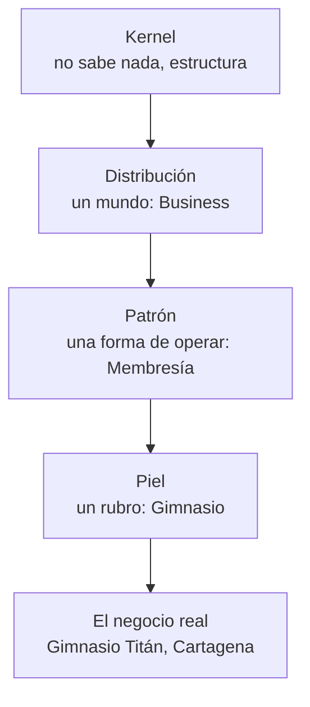

# Distribuciones

Una distribución es un **mundo** con su propio idioma que corre sobre el kernel. Se nombran por mundo, nunca por industria.

## Los cuatro niveles

| Nivel | Qué es | Cuántos | Cómo se crea |
|---|---|---|---|
| **Distribución** | Un mundo con su idioma | Pocos | Extensión en Go + traductor |
| **Patrón** | Una forma de operar con funciones propias | Pocos por mundo | Código en la distribución |
| **Piel** | Un rubro sobre un patrón | Muchos | Solo configuración (YAML) |
| **Negocio** | Un cliente real | Miles | Se registra |

## ¿Perfil o distribución nueva?

Va **dentro de Business** si responde "sí" a las tres:

1. ¿Tiene clientes a los que les vende algo?
2. ¿Cobra, factura y lleva caja y cartera?
3. ¿Lo distinto son unas pocas funciones encima de esa base?

Es una **distribución nueva** si su forma de pensar es otra: no vende, el valor no se mueve por ventas, o su idioma es completamente distinto.

## Los mundos

| Distribución | Su mundo | Estado |
|---|---|---|
| [**Thrive Business**](business/README.md) | Vender y cobrar | Primera; en construcción |
| **Thrive Comunidad** | Miembros que aportan y deciden juntos: ONG, propiedad horizontal, cooperativas | Visión |
| **Thrive Personal** | La vida de una persona: finanzas, hogar, metas | Visión |
| **Thrive Code y Agentes** | El trabajo técnico y los agentes de IA | Visión |

## Una entidad, varios mundos

Una cooperativa que vende y además gobierna a sus asociados es **un solo participante** con dos distribuciones instaladas: Business para sus ventas y Comunidad para sus asambleas. Comparten personas y valor sin duplicar nada, porque hablan con el mismo kernel.
