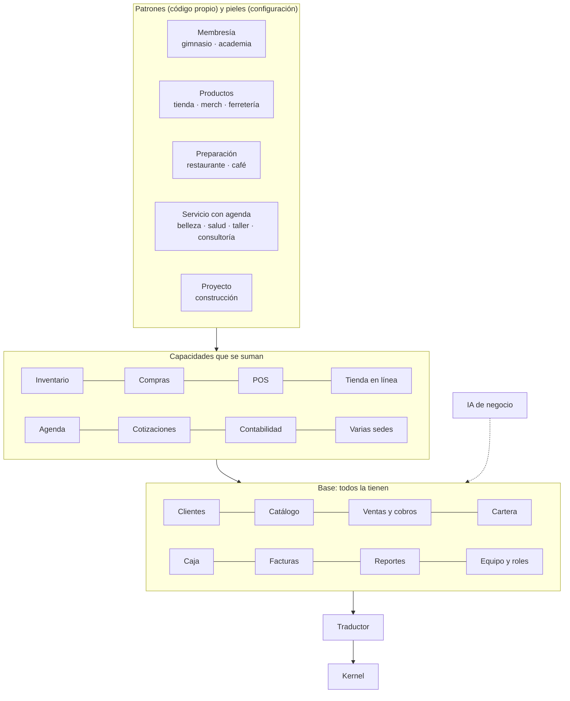

# Thrive Business

**El mundo de todo lo que vende y cobra.** Es la primera distribución de NexusThrive.

## La base

Todo negocio la tiene, sin importar el rubro:

- **Clientes:** fichas, historial, contacto.
- **Catálogo:** productos, servicios, planes, entradas.
- **Ventas y cobros:** una sola forma de registrar una venta, venga de donde venga.
- **Cartera:** lo que me deben y lo que debo, con vencimientos.
- **Caja y finanzas:** ingresos, gastos, caja menor, turnos.
- **Facturas:** recibos, facturas y facturación electrónica.
- **Reportes:** cómo va el negocio.
- **Equipo y roles:** quién trabaja y qué puede hacer.

## La IA de negocio

Cobra a los morosos, resume el día, alerta stock bajo, predice ventas y configura el negocio desde las respuestas del registro. Actúa con permisos propios y deja rastro.

## Capacidades

Se suman cuando el negocio las necesita: inventario y bodegas, compras y proveedores, punto de venta, tienda en línea y pedidos, agenda y citas, cotizaciones, contabilidad completa y varias sedes.

**El dueño no las activa.** NexusThrive y su IA configuran; el dueño solicita lo que necesite.

## El traductor

| Idioma Business | Pieza del kernel |
|---|---|
| Cliente, proveedor, empleado | Participante |
| Producto, servicio, plan, entrada | Recurso |
| Venta, pago, gasto, devolución | Intercambio |
| Deuda, membresía, cita, pedido por entregar | Compromiso |
| Vencimiento, turno, cierre de caja | Tiempo |
| Rol, permiso, política de precios | Regla |

Detalle de cada patrón en [patrones/](patrones/README.md) y los flujos en [flujos.md](flujos.md).
