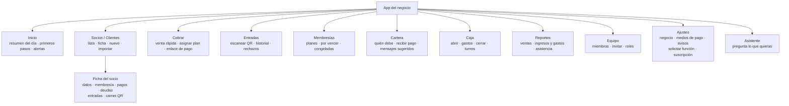
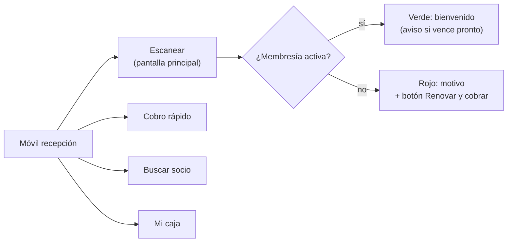

# Mapa de pantallas de Business

## Propósito

Listar las pantallas de la app de un negocio y quién ve cada una.

## Alcance

Web y móvil de recepción en la etapa 2. La consola NexusThrive está en [plataforma/consola.md](../../../02-arquitectura/plataforma/consola.md).

## Funcionamiento

### 1. La app del negocio

La palabra "Socios" sale de la piel Gimnasio. En la piel Tienda la misma pantalla dice "Clientes".

### 2. Qué ve cada rol

| Pantalla | Dueño | Administrador | Recepción |
|---|---|---|---|
| Inicio | completo | completo | turno de hoy |
| Socios | sí | sí | sí |
| Cobrar | sí | sí | sí |
| Entradas | sí | sí | sí |
| Membresías (planes) | editar | editar | ver |
| Cartera | sí | sí | recibir pagos |
| Caja | todas | todas | solo la suya |
| Reportes | sí | sí | no |
| Equipo | sí | sí | no |
| Ajustes | sí | sin suscripción | no |
| Asistente | sí | sí | preguntas de su rol |

### 3. El móvil de recepción

Sin internet: escanea contra la copia local, guarda las entradas y los cobros, y sincroniza al volver la conexión. Cada operación lleva su clave de idempotencia para no duplicarse.

## Reglas e invariantes

- Los textos visibles salen de `@nexusthrive/i18n`; la palabra "Socios" la pone la piel.
- Diseño según [06-reglas/diseno-de-experiencia.md](../../../06-reglas/diseno-de-experiencia.md).
