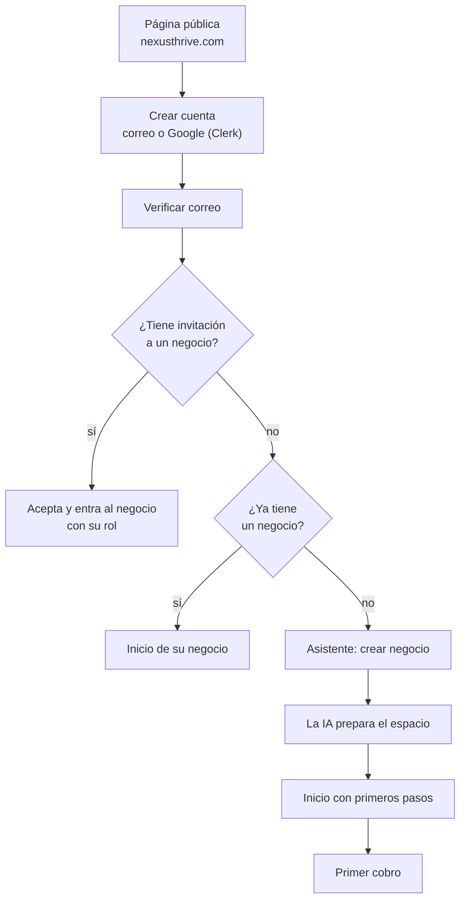
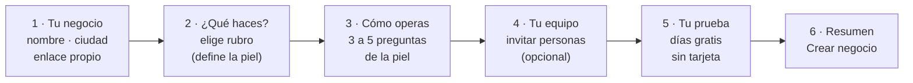
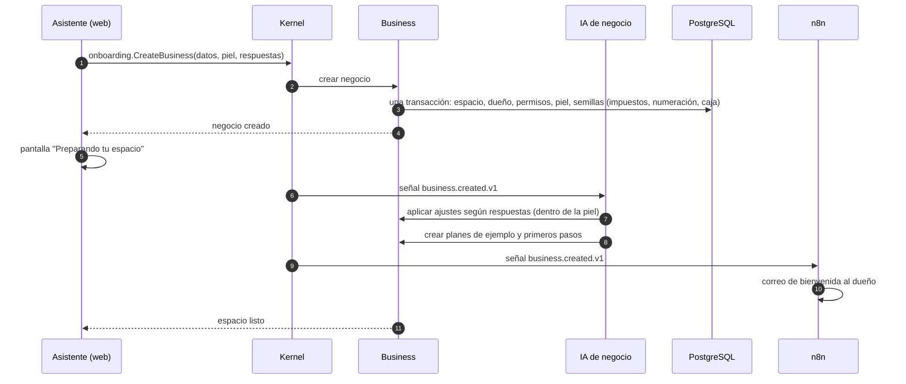
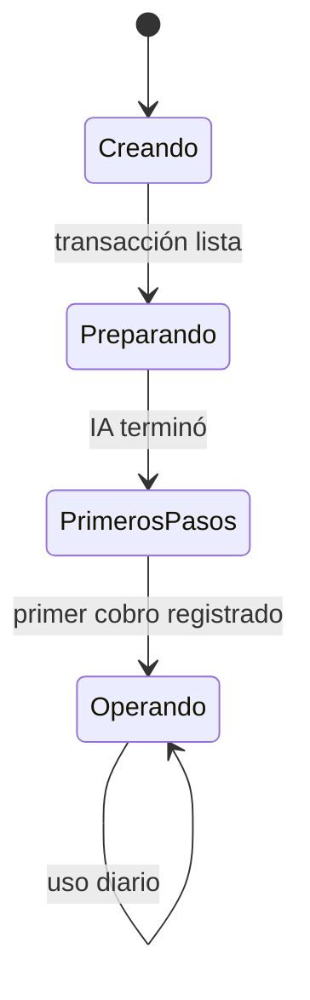
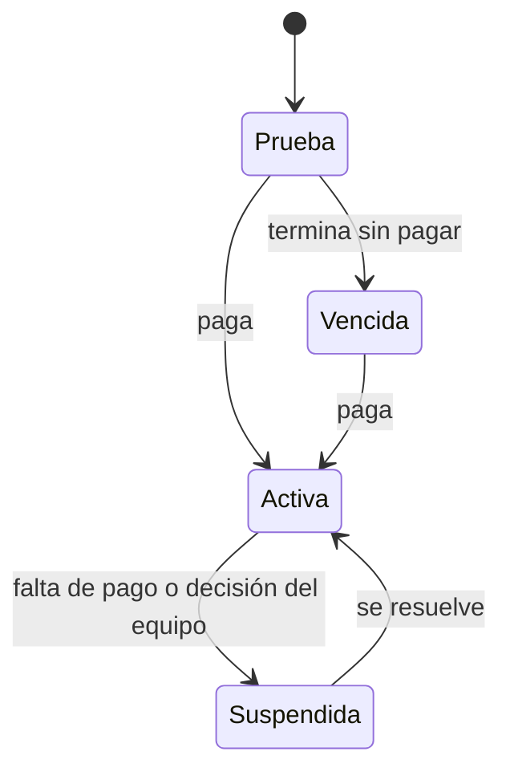
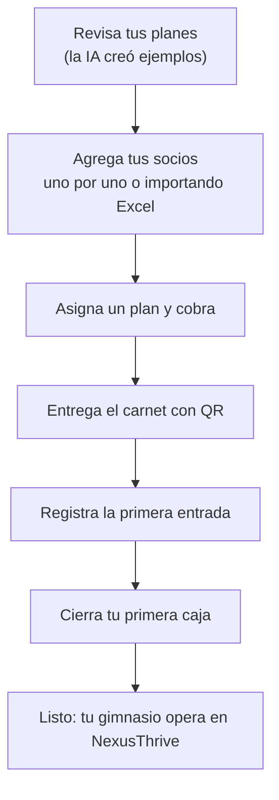
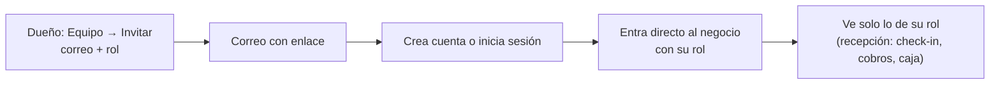

# Onboarding

## Propósito

Definir el recorrido de un dueño desde el primer clic hasta su primer cobro.

## Alcance

Registro, asistente de creación, preparación por IA, estados del negocio, primeros pasos e invitaciones. La suscripción la gestiona la [plataforma](../../../02-arquitectura/plataforma/flujos.md).

## Conceptos principales

**Meta:** que un dueño pase de "no tengo cuenta" a "cobré mi primer plan" en menos de 15 minutos, sin configurar módulos.

## Funcionamiento

### 1. El recorrido completo

### 2. El asistente de creación

Seis pasos cortos. Cada paso guarda lo escrito: si la persona cierra la ventana, vuelve donde iba.

#### Preguntas de la piel Gimnasio (paso 3)

| Pregunta | Para qué la usa la IA |
|---|---|
| ¿Cuántos socios activos tienes, más o menos? | Sugerir plan de NexusThrive y si conviene importar |
| ¿Cómo te pagan? (efectivo, transferencia, Nequi, tarjeta) | Configurar medios de pago y sugerir enlaces Wompi |
| ¿Controlas la entrada de los socios? | Activar check-in con QR y el móvil de recepción |
| ¿Les recuerdas cuándo vence su plan? | Activar recordatorios por WhatsApp |
| ¿Vendes productos (bebidas, suplementos)? | Sugerir solicitar la capacidad de inventario simple |

La IA **solo** activa lo permitido por la piel; lo demás queda como solicitud para el equipo NexusThrive.

### 3. Qué pasa por dentro al crear

Si la IA o n8n fallan, el negocio ya existe y funciona; los ajustes se reintentan solos y el estado se ve en la consola interna.

### 4. Estados del negocio

Un negocio tiene dos estados independientes: **dónde va en su arranque** y **cómo está su suscripción**.

#### Arranque

#### Suscripción

En **Vencida** el dueño puede ver y exportar sus datos, pero no registrar operaciones nuevas.

### 5. Primeros pasos del gimnasio

Una lista en el Inicio que **se marca sola** leyendo los datos. Nada se marca a mano.

### 6. Invitación de un miembro del equipo

