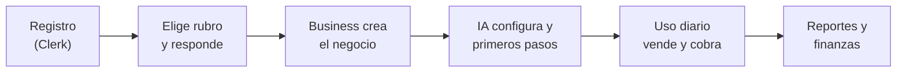
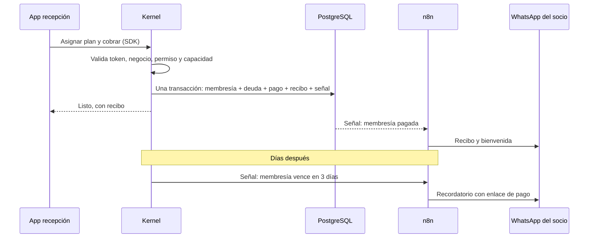
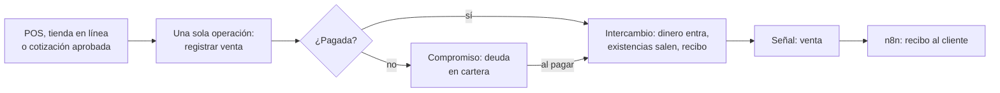
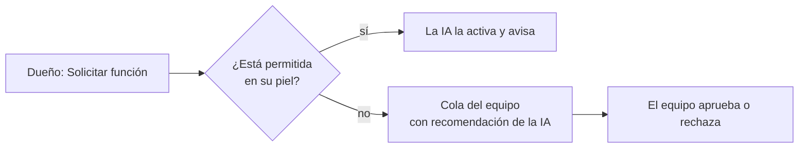

# Flujos de Thrive Business

## 1. Del registro al uso

1. **Registro.** La persona inicia sesión con Clerk.
2. **Rubro y preguntas.** Elige su rubro y responde unas pocas preguntas sobre cómo opera.
3. **Creación.** Business crea el negocio con la piel del rubro, en una sola operación: participante, dueño, capacidades y configuración.
4. **Configuración por IA.** La IA ajusta según las respuestas, solo dentro de lo permitido por la piel. Si algo necesita aprobación, va al equipo de NexusThrive.
5. **Uso diario.** Desde cualquier cara: web, móvil o escritorio.
6. **Reportes y finanzas.** Caja, cartera y resultados, también desde cualquier cara.

## 2. Cobrar una membresía, de punta a punta

Si n8n falla, el cobro ya quedó guardado: solo se atrasa el aviso. **La plata nunca depende de n8n.**

## 3. Una venta en tienda

No importa por dónde entre la venta: siempre termina en la misma operación de la base.

## 4. El dueño necesita algo nuevo

El dueño nunca ve interruptores de módulos. Pide; el sistema decide con reglas.
