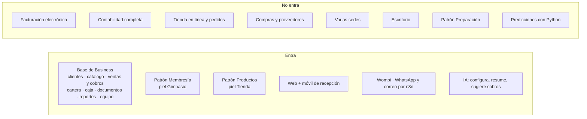

# MVP de Thrive Business

## Propósito

Definir qué se construye de Business en la etapa 2 y cuándo está terminado.

## Alcance

**Requisito previo:** la etapa 1 (base de NexusThrive) terminada hasta la fase B5. Ver [hoja de ruta](../../../02-arquitectura/hoja-de-ruta.md).

**Objetivo:** que un gimnasio pequeño opere todo su día en NexusThrive (socios, planes, cobros, deudas, caja, entradas y avisos) y pague por ello. Después, la tienda.

## Conceptos principales

## Funcionamiento

| Fase | Entrega | Terminada cuando |
|---|---|---|
| N1 | Base de Business, `apps/web` y onboarding | Un dueño se registra, crea su negocio, crea un cliente, le vende de contado y fiado, recibe el pago de la deuda y cierra caja cuadrada |
| N2 | Membresía con piel Gimnasio y `apps/mobile` | Recepción asigna un plan con cobro, el socio entra con QR y una membresía vencida es rechazada |
| N3 | Wompi, flujos de n8n e IA de negocio | El socio recibe su recibo por WhatsApp; tres días antes del vencimiento recibe recordatorio con enlace de pago; al pagar, la deuda se salda sola |
| N4 | Piloto | Diez gimnasios lo usan a diario durante un mes y al menos la mitad paga al terminar la prueba |
| N5 | Productos con piel Tienda | Una tienda vende desde el POS con existencias que cuadran |
| N6 | Preparación con piel Restaurante | Un restaurante toma una comanda, la cocina la ve y la cuenta se cobra dividida |

### Roles del negocio

| Rol | Qué hace |
|---|---|
| Dueño | Todo en su negocio: equipo, planes, precios, reportes, solicitar funciones |
| Administrador | Igual que el dueño, sin cerrar el negocio ni cambiar la suscripción |
| Recepción | Clientes, cobros, check-in y caja de su turno; no ve reportes de ganancias |

## Referencias

- [operaciones.md](operaciones.md): operaciones y señales.
- [business-completo.md](business-completo.md): una operación atravesando todas las capas.
- [Modelo de datos `business`](../../../02-arquitectura/modelo-de-datos/business.md).
- [Experiencia](../experiencia/README.md).
