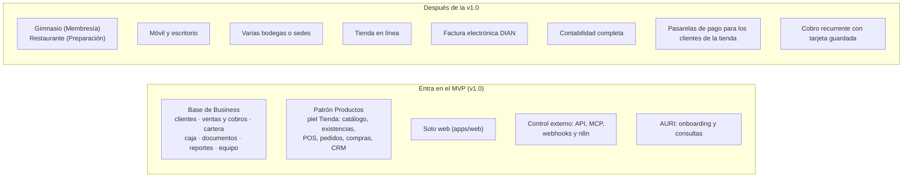

# MVP de Thrive Business

## Propósito

Definir qué se construye de Business en la etapa 2 y cuándo está terminado.

## Alcance

**Requisito previo:** la etapa 1 (base de NexusThrive) terminada hasta la fase B5. Ver [hoja de ruta](../../../02-arquitectura/hoja-de-ruta.md).

**Objetivo:** que una tienda pequeña opere todo su día en NexusThrive desde la web (ventas, existencias, compras, pedidos, cartera, caja y reportes) y pague por ello. Gimnasio y restaurante vienen después de la v1.0 ([ADR-0017](../../../05-decisiones/0017-mvp-web-tienda-primero.md)).

## Conceptos principales

## Funcionamiento

| Fase | Entrega | Terminada cuando |
|---|---|---|
| N1 | Base de Business, `apps/web` y onboarding | Un dueño se registra, crea su tienda, invita a un cajero, abre caja, vende de contado y fiado, recibe un abono y cierra caja cuadrada; un webhook de esa venta llega a n8n |
| N2 | Tienda (patrón Productos, piel Tienda) | Una tienda vende desde el POS con lector; las existencias cuadran tras compras, ventas, devoluciones, pedidos y un conteo; la cartera coincide con el libro; cada operación se ejecuta y observa por API, MCP y n8n |
| Después de la v1.0 | Membresía con piel Gimnasio, Preparación con piel Restaurante, móvil y escritorio | Se definen en su momento con un ADR |

### Roles del negocio

| Rol | Qué hace |
|---|---|
| Dueño | Todo en su negocio: equipo, planes, precios, reportes, solicitar funciones |
| Administrador | Igual que el dueño, sin cerrar el negocio ni cambiar la suscripción |
| Cajero | Clientes, ventas, cobros y caja de su turno; no ve reportes de ganancias |

## Referencias

- [operaciones.md](operaciones.md): operaciones y señales.
- [business-completo.md](business-completo.md): una operación atravesando todas las capas.
- [Modelo de datos `business`](../../../02-arquitectura/modelo-de-datos/business.md).
- [Experiencia](../experiencia/README.md).
