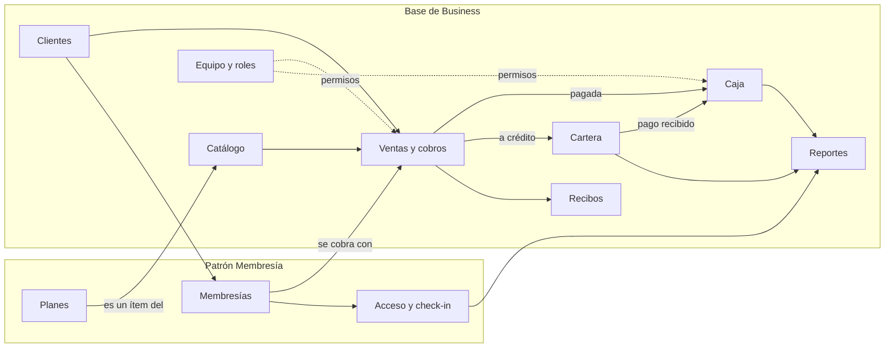
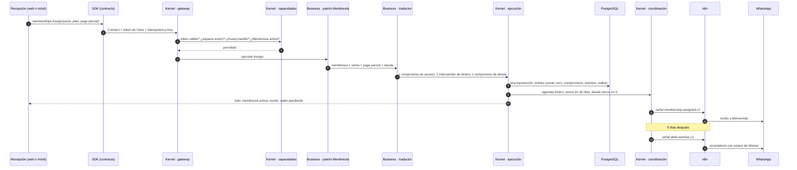
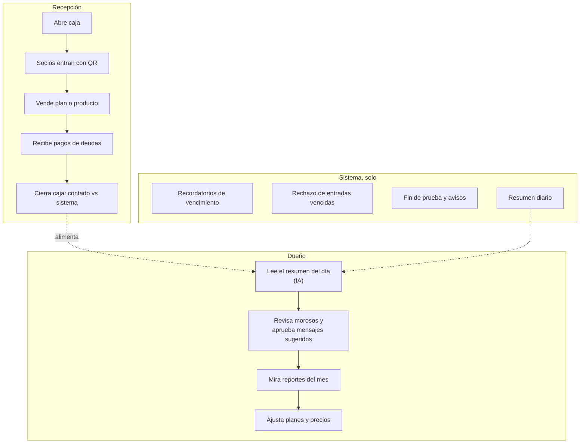

# Business completo: cómo se toca todo

## Propósito

Mostrar la primera aplicación de NexusThrive (Thrive Business con la piel Gimnasio) recorriendo **todas** las capas: cara, contrato, kernel, distribución, base de datos, señales, integraciones e IA.

## Alcance

Etapa 2, sobre la base terminada en la etapa 1.

## Funcionamiento

### 1. Mapa de módulos y cómo se conectan

Una membresía **no tiene su propio cobro**: usa Ventas y cobros de la base. Por eso la caja, la cartera y los reportes ya la ven sin código extra.

### 2. Una operación atravesando todas las capas

Asignar un plan mensual a un socio que paga la mitad y queda debiendo el resto:

### 3. Lo que ve cada actor en un día

### 4. Dónde vive cada pieza en el código

| Pieza | Carpeta |
|---|---|
| Pantallas de recepción y dueño | `packages/app` + `apps/web` + `apps/mobile` |
| Operaciones `business.v1` | `contracts/proto/business/v1/` |
| Puertas, permisos, transacciones, reloj | `kernel/` |
| Clientes, ventas, cartera, caja, recibos, reportes | `distributions/business/base/` |
| Planes, membresías, acceso | `distributions/business/patterns/membership/` |
| Vocabulario, roles y preguntas del gimnasio | `distributions/business/skins/gym.yaml` |
| Wompi | `distributions/business/adapters/wompi/` |
| Configuración y resumen por IA | `distributions/business/ai/` |
| Recibo, bienvenida, recordatorios | `integrations/n8n/workflows/` |
