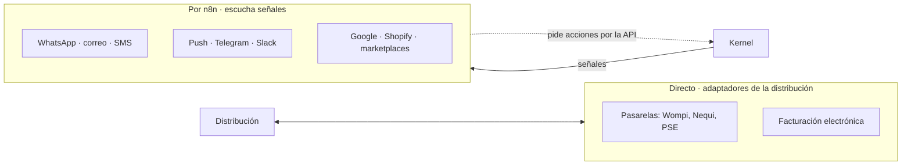

# Integraciones

## Propósito

Definir cómo se conecta NexusThrive con otras aplicaciones, con agentes de IA y con los canales de aviso.

## Alcance

| Página | Responde |
|---|---|
| [puertas.md](puertas.md) | ¿Por dónde entra y sale todo? API, MCP y webhooks |
| [avisos.md](avisos.md) | ¿Cómo llegan los avisos por WhatsApp, correo, SMS o push? |
| [identidad.md](identidad.md) | ¿Cómo se autentica cada actor? |

## Conceptos principales

> **Si mueve plata o cambia la verdad, va directo. Si comunica o conecta, va por n8n.**

## Reglas e invariantes

1. Lo crítico necesita verificación de firma, una sola transacción y cero duplicados. Si n8n se cae, un pago no puede quedar en el aire.
2. n8n nunca guarda ni mueve valor por su cuenta; siempre pide al kernel.
3. Usar n8n con las credenciales de cada cliente requiere la licencia comercial de n8n (Embed). Pendiente de confirmar antes de construir esa parte.

## Decisiones relacionadas

- [ADR-0005 · Lo crítico directo, lo demás por n8n](../05-decisiones/0005-integraciones.md)
