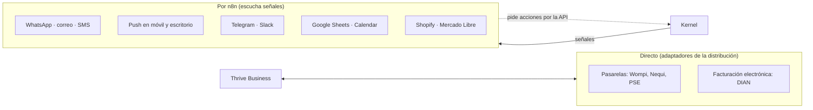

# Integraciones

## La regla

> **Si mueve plata o cambia la verdad, va directo. Si comunica o conecta, va por n8n.**

**Por qué lo crítico va directo:** necesita verificación de firma, una sola transacción y cero duplicados. Si n8n se cae, un pago no puede quedar en el aire.

**Por qué lo demás va por n8n:** cambia seguido, cada cliente lo quiere distinto y no debe ensuciar el kernel.

## Las puertas del kernel

| Puerta | Para quién | Cómo se protege |
|---|---|---|
| **API** | Las caras, n8n, sistemas de terceros | Token o llave por negocio, alcances, límites, idempotencia |
| **MCP** | Agentes de IA (propios o de terceros) | La misma llave y permisos; la IA es un participante más |
| **Webhooks salientes** | Terceros que quieren enterarse | Firmados, con reintentos y versión |
| **Webhooks entrantes** | Pasarelas y servicios | Firma verificada; un aviso nunca se procesa dos veces |

Todas pasan por el mismo motor de operaciones: agregar una puerta no duplica lógica.

## Avisos

El dueño y sus clientes reciben avisos por el canal que prefieran: WhatsApp, correo, SMS, push, Telegram. La señal es la misma; n8n decide el canal según la configuración y el consentimiento del destinatario.

## Identidad

- **Clerk** prueba quién eres y entrega un token.
- **El kernel** valida el token y decide qué puedes hacer.
- Los participantes, roles y permisos viven en el kernel, no en Clerk. Cambiar de proveedor de identidad no toca nada más.

## Licencia de n8n

Usar n8n con las credenciales de cada cliente (su WhatsApp, su Google) requiere la licencia comercial de n8n (Embed). Pendiente de confirmar con n8n antes de construir esa parte.
