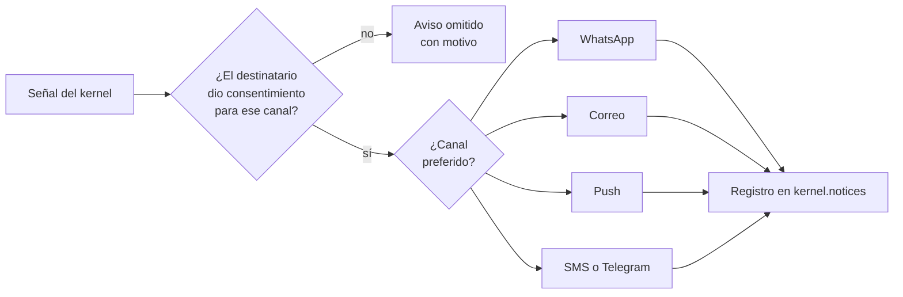

# Avisos

## Propósito

Definir cómo NexusThrive avisa a las personas por cualquier canal.

## Alcance

WhatsApp, correo, SMS, push y Telegram. El contenido de cada aviso lo define la distribución.

## Funcionamiento

## Reglas e invariantes

1. Sin consentimiento registrado en `contact_points` no se envía nada; si la persona se dio de baja, tampoco.
2. Cada aviso queda en `kernel.notices` con su estado: enviado, fallido u omitido, y el motivo.
3. La misma señal puede producir avisos en varios canales; el kernel no conoce los canales, solo la señal.
