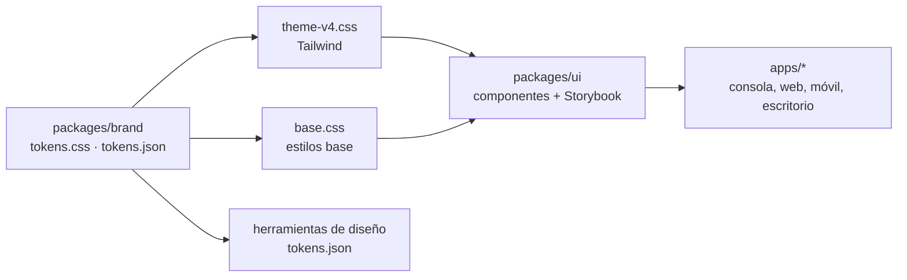

# Sistema de diseño

## Propósito

Definir cómo se ve, cómo suena y cómo se comporta toda interfaz de NexusThrive: la consola, las apps de las distribuciones, el sitio y las piezas de marca.

## Alcance

| Página | Responde |
|---|---|
| [marca.md](marca.md) | ¿Cómo se usan el logo, el color y la tipografía? |
| [tono.md](tono.md) | ¿Cómo escribe NexusThrive? |
| [tokens.md](tokens.md) | ¿Qué valores existen y cuándo se usa cada uno? |
| [interaccion.md](interaccion.md) | ¿Diálogo, panel, ventana flotante, página o en línea? |
| [movimiento.md](movimiento.md) | ¿Cuándo y cómo se anima algo? |
| [estados.md](estados.md) | ¿Qué muestra una pantalla cargando, vacía, con error o sin permiso? |
| [accesibilidad.md](accesibilidad.md) | ¿Qué exige WCAG 2.2 AA y cómo se verifica? |
| [calidad.md](calidad.md) | ¿Qué se revisa antes de abrir un PR con interfaz? |

Las reglas generales de pantalla están en [diseno-de-experiencia.md](../diseno-de-experiencia.md). Esta carpeta las detalla.

## Conceptos principales

- **Marca:** sale del logo y no cambia. Negro y oro, la N con su corte a −24°, Montserrat.
- **Lenguaje de interfaz:** tranquilo y limpio sin perder densidad. Fondo papel cálido, superficies blancas, bordes sutiles, radios suaves y el oro como acento de acción.
- **Token:** un valor con nombre (color, radio, sombra, capa, duración). Es la única forma de escribir un valor en un componente.
- **Componente compartido:** pieza de `@nexusthrive/ui` construida con tokens y documentada primero en Storybook.

## Funcionamiento

1. Los valores viven en `packages/brand/css/tokens.css`, con su espejo `tokens/tokens.json`.
2. `theme-v4.css` los nombra para Tailwind; no repite valores.
3. `@nexusthrive/ui` construye los componentes con esos nombres. Cada componente nace en Storybook con sus estados.
4. Las apps solo componen piezas de `@nexusthrive/ui`. No crean estilos propios para lo que ya existe.

## Reglas e invariantes

1. **El código manda.** Si un documento y los tokens discrepan, se corrige el documento en el mismo cambio.
2. **Nada suelto.** Ningún componente escribe un color, una sombra, un `z-index` o una duración. Si falta, se agrega el token.
3. **Un espejo, un cambio.** `tokens.css` y `tokens.json` cambian juntos.
4. **Storybook primero.** El diseño fluye de Storybook a las apps, nunca al revés.
5. **Una variante antes que un componente nuevo.** Un componente nuevo necesita dos usos reales.
6. **La marca no se negocia por pantalla.** Un cambio de logo, paleta o tipografía exige un ADR.

## Ejemplo

Una pantalla necesita un borde más marcado para un campo. No escribe `#d2d0ca`: usa `--border-input`. Si ningún token sirve, se agrega uno en `tokens.css` y `tokens.json`, se documenta en [tokens.md](tokens.md) y se revisa en Storybook.

## Decisiones relacionadas

- [ADR-0016 · Sistema de diseño y licencia de fuentes](../../05-decisiones/0016-sistema-de-diseno.md)
- [ADR-0013 · Internacionalización](../../05-decisiones/0013-internacionalizacion.md)

## Referencias

- [`packages/brand`](../../../packages/brand/README.md)
- [`packages/ui`](../../../packages/ui/README.md)
