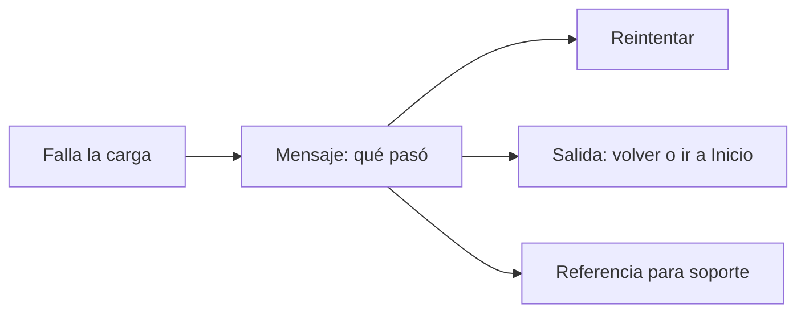

# Estados

## Propósito

Definir qué muestra una pantalla en cada estado para que nunca quede en blanco ni deje a la persona sin salida.

## Alcance

Toda vista, bloque o panel: cargando, vacía, sin coincidencias, con datos, con error y sin permiso.

## Conceptos principales

| Estado | Qué muestra |
|---|---|
| **Cargando** | Un esqueleto con la forma de lo que viene; la N solo cuando no se conoce la forma |
| **Vacía** | Cómo se verá con datos, para qué sirve y un botón para crear lo primero |
| **Sin coincidencias** | El mensaje y cómo salir («Limpia la búsqueda») |
| **Con datos** | El contenido |
| **Error** | Qué pasó, un botón para reintentar, una salida y una referencia |
| **Sin permiso** | Qué rol lo permite y a quién pedirlo |

## Funcionamiento

### Vista vacía

Cuatro capas, de atrás hacia adelante:

1. **Datos de ejemplo de fondo.** La vista como se verá llena, desenfocada y difuminada hacia el centro. Es decoración: sin foco ni clics, con datos fijos y creíbles. **No** es un esqueleto de carga.
2. **Icono del área** en un recuadro de 48 px.
3. **Invitación:** un título que nombra lo que falta («Aún no tienes clientes») y una línea que dice para qué sirve.
4. **Acciones:** el botón principal en oro con el nombre exacto («Nuevo cliente»), una acción secundaria si existe («Importar desde Excel») y tres primeros pasos cortos.

Un bloque pequeño vacío (una tarjeta, la actividad reciente) solo lleva texto a la izquierda y la N en la esquina.

### Carga

- Página: esqueleto de la página. El sistema completo: el armazón (barra lateral y superior) con el esqueleto de la ruta, nunca una pantalla en blanco.
- Dentro de un panel o lista: filas de esqueleto.
- Si la vista estaba vacía la última vez, su carga muestra el esqueleto del estado vacío.

### Error

## Reglas e invariantes

1. Toda pantalla diseña sus estados antes de su caso feliz, y los muestra en Storybook.
2. El vacío no parece una carga: nada de barras grises.
3. Los datos de ejemplo nunca muestran cifras presentadas como reales.
4. Con búsqueda o filtros activos no hay datos de ejemplo ni primeros pasos: solo el mensaje y la salida.
5. Sin scroll en el estado vacío a 320, 390 y 1440 px.
6. El permiso se explica desde la matriz de permisos, no con un texto escrito a mano.

## Ejemplo

Lista de clientes vacía: fondo con una tabla de ejemplo desenfocada; icono de personas; «Aún no tienes clientes»; «Registra el primero para llevar su historial, sus citas y sus cobros»; «Nuevo cliente» en oro, «Importar desde Excel» en contorno; tres pasos: citas con recordatorio, cobros y cartera, todo en su ficha.

## Decisiones relacionadas

- [ADR-0016 · Sistema de diseño y licencia de fuentes](../../05-decisiones/0016-sistema-de-diseno.md)

## Referencias

- [diseno-de-experiencia.md](../diseno-de-experiencia.md), regla 4
- [tono.md](tono.md)
