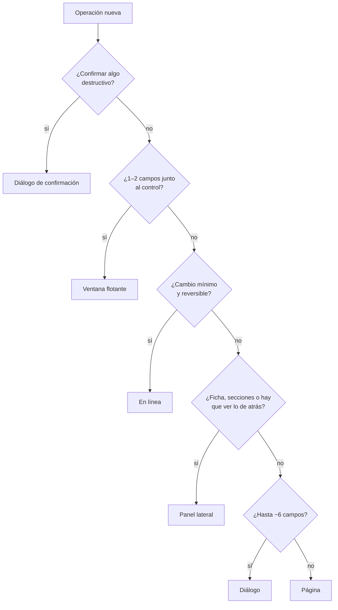

# Interacción

## Propósito

Hacer que el mismo tipo de operación se comporte igual en toda la interfaz.

## Alcance

Cómo se abre, se llena, se confirma y se cierra cualquier operación: diálogo, panel lateral, ventana flotante, página o edición en línea.

## Conceptos principales

| Patrón | Qué es |
|---|---|
| **Diálogo** | Modal centrado en escritorio; hoja inferior en móvil |
| **Panel lateral** | Modal a la derecha y a alto completo; casi pantalla completa en móvil |
| **Ventana flotante** | Junto al control que la abre; sin scroll propio |
| **Página** | Ruta propia con encabezado |
| **En línea** | El cambio ocurre en su lugar |

## Funcionamiento

### Decisión rápida

### Matriz

| | Diálogo | Panel lateral | Ventana flotante | Página | En línea |
|---|---|---|---|---|---|
| **Para** | Crear rápido, editar pocos campos, confirmar | Ficha de un registro, varias secciones, ver actividad sin perder la lista | Acciones rápidas, 1–2 campos, ayuda «?» | Onboarding, flujos con pasos, editores, lo que necesita enlace propio | Renombrar, marcar, expandir |
| **No para** | Formularios largos, diálogos dentro de diálogos | Confirmaciones, un solo campo | Formularios largos, contenido esencial en móvil | Crear algo de 3 campos | Validación de servidor compleja |
| **Escritorio** | `sm` 440 · `md` 520 · `lg` 640 · `xl` 768 | Derecha: 440 · `lg` 560 | Junto al control; cambia de lado si no cabe | Ruta con encabezado | En su lugar |
| **Móvil** | Hoja inferior (hasta 88 % del alto), se cierra arrastrando | Hoja casi a pantalla completa | Igual; si no cabe, diálogo | Una columna | Igual |
| **Teclado** | Foco atrapado; Escape cierra si no está guardando; Enter envía | Igual | Escape cierra; Tab sale | Normal | Enter guarda, Escape cancela |
| **Foco** | Al abrir, primer campo; al cerrar, vuelve al botón que lo abrió | Igual | Al cerrar, vuelve al disparador | Título o primer campo | Se queda en el control |
| **Carga** | Botón «Guardando…»; no se puede cerrar | Igual | Botón con carga | Esqueleto de página | Indicador en el control |
| **Error** | Aviso arriba, error en el campo, foco al primer inválido; no borra lo escrito | Igual | Error bajo el campo | Aviso en la sección | Notificación y valor anterior |
| **Éxito** | Cierra y notifica | Cierra y notifica (o sigue abierto si es una ficha en uso) | Cierra y notifica | Notifica y redirige si aplica | Confirmación breve |

## Reglas e invariantes

1. **Un patrón por tipo de operación.** «Nuevo cliente» y «Nuevo producto» usan el mismo patrón si tienen el mismo tamaño.
2. **Sin diálogos dentro de diálogos.** Única excepción: confirmar una acción destructiva desde un panel abierto. Escape cierra solo la confirmación.
3. **Sin `window.confirm` ni `alert`.** Se usa el diálogo de confirmación de `@nexusthrive/ui`.
4. **Todo diálogo y panel es modal** y bloquea el fondo.
5. **Cerrar nunca pierde un guardado a medias.** Mientras guarda, no se puede cerrar.
6. **Lo que abre dice qué hace:** «Nuevo cliente», «Anular venta». El título repite esa intención.
7. **Pie: «Cancelar» a la izquierda, la acción a la derecha.** La acción destructiva va en rojo y nunca recibe el foco.
8. **Crear sin salir.** Lo frecuente (un cobro, un gasto, un socio) se crea en una hoja encima de la pantalla actual, con un enlace «Abrir en el panel completo».
9. **Documentos a pantalla completa.** Facturas y recibos se ven completos, con impresión limpia; sus acciones rápidas se abren encima.
10. **Un componente por necesidad.** Las pantallas componen las piezas de `@nexusthrive/ui` (diálogo, panel, confirmación, campo, ayuda, notificación); no las recrean.

## Ejemplo

Anular una venta desde su ficha: la ficha es un panel lateral. «Anular venta» abre una confirmación encima, con el foco en «Cancelar». Si se confirma, la confirmación se cierra, el panel sigue abierto con el estado «Anulada» y una notificación lo confirma.

## Decisiones relacionadas

- [ADR-0016 · Sistema de diseño y licencia de fuentes](../../05-decisiones/0016-sistema-de-diseno.md)

## Referencias

- [accesibilidad.md](accesibilidad.md)
- [movimiento.md](movimiento.md)
