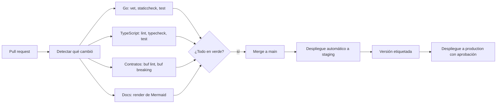

# Integración y despliegue continuos

## Propósito

Definir qué verifica la integración continua y cómo llega un cambio a producción.

## Alcance

GitHub Actions (`.github/workflows/`) y los entornos `staging` y `production`.

## Funcionamiento

## Reglas e invariantes

1. El CI solo corre los trabajos de lo que cambió.
2. Ningún merge con el CI en rojo.
3. `main` se despliega solo a `staging`; `production` exige una versión etiquetada y aprobación.
4. Las migraciones de base de datos se aplican antes de desplegar el binario y deben ser compatibles con la versión anterior.
5. Todo despliegue se puede revertir a la versión anterior.
