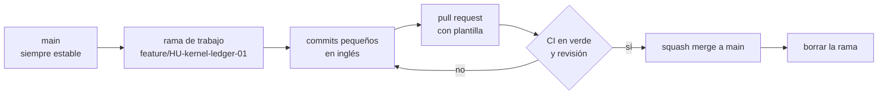

# Flujo de git

## Propósito

Definir cómo se trabaja con ramas para que `main` siempre esté estable.

## Alcance

Todas las ramas del repositorio.

## Funcionamiento



## Reglas e invariantes

1. **Nunca commit directo a `main`.** Todo entra por pull request.
2. **Nombre de rama:** debe cumplir esta expresión regular, en inglés y en minúsculas:

   ```text
   ^(feature|fix|chore|hotfix)/HU-[a-z0-9]+(-[a-z0-9]+)*-[0-9]{2}$
   ```

   - Prefijo: `feature`, `fix`, `chore` u `hotfix`. No se aceptan `feat/`, `docs/` ni otro.
   - `HU-<slug>-<nn>`: la historia, con un `slug` en inglés separado por guiones y su número de dos dígitos.
   - Las ramas de integración de un sprint se llaman `sprint/S<nn>` (por ejemplo `sprint/S01`). Las ramas de Dependabot (`dependabot/**`) también se aceptan.
   - Válidas: `feature/HU-kernel-ledger-01`, `fix/HU-outbox-retry-02`, `chore/HU-scaffolding-01`, `sprint/S01`.
   - Inválidas: `feat/HU-kernel-ledger-01` (prefijo), `docs/HU-platform-console-01` (prefijo), `feature/kernel-ledger` (sin `HU-` ni número), `feature/HU-Kernel-Ledger-01` (mayúsculas), `feature/HU-kernel-ledger-1` (un solo dígito).
   - El tipo de commit (`feat`, `fix`, `docs`, `chore`…) es distinto del prefijo de rama: una rama `feature/HU-kernel-ledger-01` puede tener commits `feat(kernel): …` y `docs(kernel): …`. Ver [commits](commits.md).
   - Un hook local y el job `branch-name` del CI aplican esta regla.
3. **Una rama, una historia.** Si crece, se divide.
4. **Squash merge:** cada historia queda como un solo commit en `main`.
5. **Ramas cortas:** se integran en días, no en semanas. Si `main` avanza, se actualiza con `rebase`.
6. **Sin reescribir `main`.** Nunca `push --force` sobre `main`.
