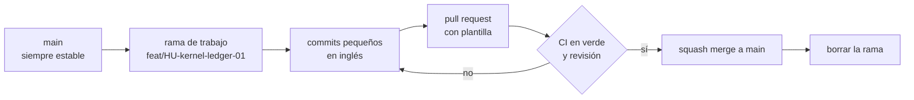

# Flujo de git

## Propósito

Definir cómo se trabaja con ramas para que `main` siempre esté estable.

## Alcance

Todas las ramas del repositorio.

## Funcionamiento

## Reglas e invariantes

1. **Nunca commit directo a `main`.** Todo entra por pull request.
2. **Nombre de rama:** `<type>/HU-<slug>-<nn>`, en inglés.
   - `type`: `feat`, `fix`, `docs`, `refactor`, `test`, `chore`, `perf`.
   - `slug`: qué hace, en inglés y con guiones.
   - `nn`: número de la historia.
   - Ejemplos: `feat/HU-kernel-ledger-01`, `docs/HU-platform-console-01`, `fix/HU-outbox-retry-02`.
3. **Una rama, una historia.** Si crece, se divide.
4. **Squash merge:** cada historia queda como un solo commit en `main`.
5. **Ramas cortas:** se integran en días, no en semanas. Si `main` avanza, se actualiza con `rebase`.
6. **Sin reescribir `main`.** Nunca `push --force` sobre `main`.
